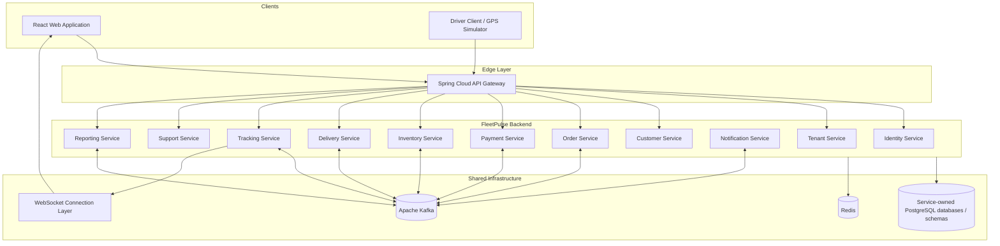
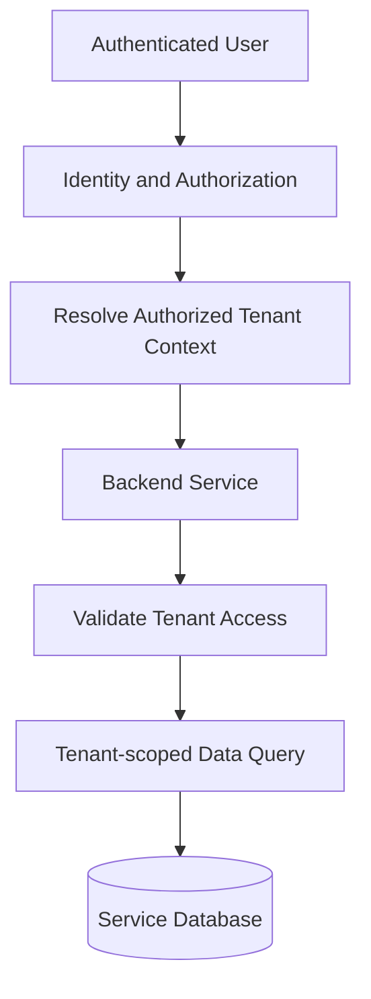
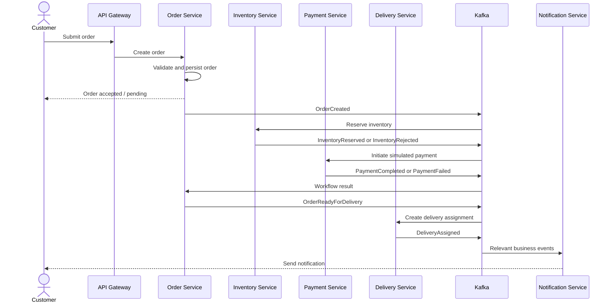
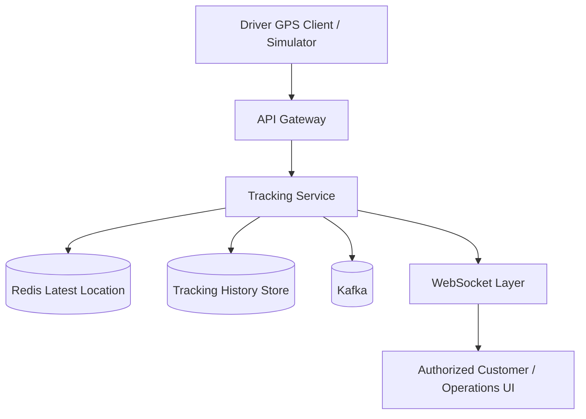
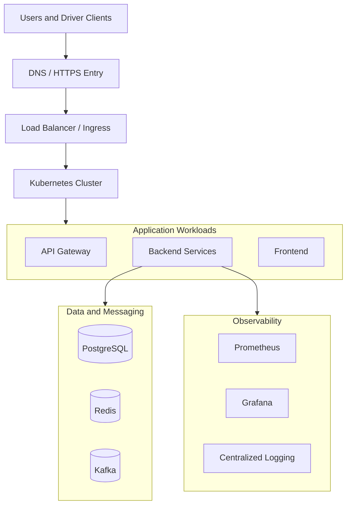
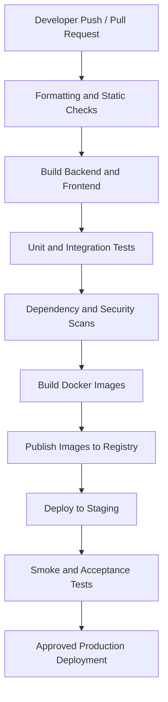

# FleetPulse – High-Level Design (HLD) v1.0

**Document ID:** FP-DOC-002  
**Project:** FleetPulse – Smart Logistics & Real-Time Delivery Management System  
**Version:** 1.0  
**Status:** Draft – Pending Team Review  
**Prepared:** November 2026  
**Related Document:** FP-DOC-001 – FleetPulse BRD & SRS v1.0

---

# 1. Document Purpose

This document describes the proposed high-level architecture and technical design of FleetPulse, a multi-tenant SaaS logistics and real-time delivery management platform.

It establishes:

- Overall system architecture and architectural principles.
- Proposed microservice boundaries and responsibilities.
- Communication patterns between services.
- Data ownership and database strategy.
- Tenant isolation strategy.
- Authentication and authorization architecture.
- Real-time GPS tracking architecture.
- External integrations and infrastructure.
- Deployment, scalability, monitoring, and resilience strategies.
- Key technical decisions and unresolved design questions.

This HLD serves as the foundation for the Low-Level Design (LLD), API contracts, database design, implementation planning, and deployment design.

# 2. Architecture Goals

FleetPulse architecture must support the following goals:

| Goal | Architectural approach |
|---|---|
| Multi-tenancy | Tenant-aware authentication, authorization, and data access |
| Modularity | Domain-oriented service boundaries |
| Scalability | Independently scalable services where justified |
| Reliability | Timeouts, retries, circuit breakers, and fault isolation |
| Real-time tracking | GPS ingestion and WebSocket-based updates |
| Security | OAuth2/OIDC-compatible identity, JWT, RBAC |
| Maintainability | Clear ownership, API contracts, automated tests |
| Observability | Centralized logs, metrics, traces, and health checks |
| Extensibility | Event-driven integration and versioned APIs |
| Deployment | Containerized services and automated CI/CD |

# 3. Proposed Technology Stack

| Layer | Proposed technology |
|---|---|
| Programming language | Java 21 |
| Backend framework | Spring Boot |
| Microservices | Spring Cloud ecosystem |
| API Gateway | Spring Cloud Gateway |
| Security | Spring Security, OAuth2 Resource Server, JWT |
| Frontend | React, TypeScript |
| Frontend build | Vite |
| Relational database | PostgreSQL |
| ORM | Spring Data JPA / Hibernate |
| Database migrations | Flyway |
| Messaging | Apache Kafka |
| Caching | Redis |
| Real-time communication | WebSocket / STOMP |
| API documentation | OpenAPI / Swagger |
| Testing | JUnit 5, Mockito, Testcontainers |
| Containerization | Docker |
| Container orchestration | Kubernetes |
| CI/CD | GitHub Actions |
| Metrics | Prometheus |
| Dashboards | Grafana |
| Logging | Structured logs with an ELK-compatible stack |
| Cloud | AWS |

**Version policy:** Exact dependency and infrastructure versions will be pinned during project initialization and recorded in the repository.

# 4. System Architecture Overview

FleetPulse will follow a domain-oriented, distributed architecture.

The frontend communicates with backend services through an API Gateway. The gateway provides a centralized entry point for routing and cross-cutting request handling.

Backend services own their business capabilities and data. Services communicate through synchronous REST APIs when an immediate response is required and Kafka events when asynchronous processing is more appropriate.

Redis supports caching and selected real-time or short-lived state use cases. PostgreSQL provides durable relational storage.

## 4.1 High-Level Architecture Diagram



*Note: This is a logical architecture. It does not imply that every service must be independently deployed from the first development milestone.*

# 5. Architectural Style and Principles

## 5.1 Architectural Style

The proposed architecture uses:

- Domain-oriented microservices.
- API Gateway pattern.
- Event-driven communication.
- Database-per-service ownership.
- Multi-tenant SaaS architecture.
- Stateless backend request handling wherever practical.
- Containerized deployment.

## 5.2 Core Principles

1. Each service owns its business logic and persistence.
2. No service directly reads or writes another service's database.
3. Cross-service data exchange happens through documented APIs or events.
4. Every tenant-owned operation must enforce tenant authorization.
5. APIs and events must be versioned and documented.
6. Critical business state changes must be auditable.
7. Distributed workflows must tolerate retries and duplicate messages.
8. Avoid introducing infrastructure that does not solve a demonstrated requirement.

# 6. Proposed Microservice Architecture

The following boundaries are logical starting points. They will be reviewed against domain dependencies, team capacity, deployment complexity, and workload before being finalized.

## 6.1 API Gateway Service

**Responsibility:**

- Single entry point for frontend and external clients.
- Request routing.
- Authentication token validation at the edge.
- Rate limiting and request-size restrictions.
- Correlation ID propagation.
- CORS configuration.
- Gateway-level logging.

The gateway is not the owner of business rules or domain data.

## 6.2 Identity Service

**Responsibility:**

- User registration and authentication.
- Credential management.
- Access token and refresh token lifecycle.
- Role and permission management.
- Account activation, suspension, and recovery.
- User identity administration.

**Important:** Tenant membership and tenant-specific role assignments must be represented in the authorization model.

## 6.3 Tenant Service

**Responsibility:**

- Tenant registration and onboarding.
- Tenant profile and configuration.
- Tenant status and lifecycle.
- Tenant-level settings.
- Tenant membership administration.
- Tenant-level operational configuration.

## 6.4 Customer Service

**Responsibility:**

- Customer profiles.
- Customer contact information.
- Customer addresses.
- Customer preferences.
- Customer account history.

## 6.5 Order Service

**Responsibility:**

- Order creation and management.
- Order validation.
- Order lifecycle and status transitions.
- Order item management.
- Order cancellation.
- Order history.
- Coordination of order-related workflows.

## 6.6 Payment Service

**Responsibility:**

- Simulated payment processing for v1.
- Payment initiation.
- Payment status management.
- Payment transaction records.
- Refund simulation.
- Payment event publication.

The first release will not process real financial transactions.

## 6.7 Inventory Service

**Responsibility:**

- Warehouse inventory.
- Stock availability.
- Stock reservation and release.
- Inventory adjustments.
- Inventory movement history.
- Low-stock notifications through events.

## 6.8 Delivery Service

**Responsibility:**

- Delivery assignment.
- Driver availability and assignment.
- Delivery lifecycle management.
- Pickup and delivery confirmation.
- Proof-of-delivery metadata.
- Delivery exception handling.

## 6.9 Tracking Service

**Responsibility:**

- GPS location ingestion.
- Location validation.
- Latest driver location.
- Tracking history.
- Delivery tracking state.
- Real-time location updates.
- Publishing tracking events.

Redis may store the latest location for fast access, while durable tracking history is persisted according to the detailed retention design.

## 6.10 Notification Service

**Responsibility:**

- Email and in-app notifications.
- Notification templates.
- Notification preferences.
- Event-driven notification delivery.
- Delivery status and retry handling.

External notification providers will be selected during LLD and integration design.

## 6.11 Support Service

**Responsibility:**

- Support ticket creation.
- Ticket assignment.
- Ticket status and priority.
- Customer and operational support history.
- Internal support notes.

## 6.12 Reporting Service

**Responsibility:**

- Operational dashboards.
- Order and delivery summaries.
- Tenant-level reports.
- Aggregated business metrics.
- Exportable reports.

Reporting should use service-owned read models or event-fed projections rather than querying other services' databases directly.

# 7. Service Communication Architecture

FleetPulse will use two main communication patterns.

## 7.1 Synchronous Communication – REST

REST APIs will be used when a service needs an immediate response.

Examples:

- Frontend requests an order.
- Order Service validates a customer reference.
- Gateway routes an authenticated request.
- Tenant administration requests tenant configuration.

REST communication must include:

- Timeouts.
- Defined error responses.
- Correlation IDs.
- API versioning.
- Authentication and authorization.
- Appropriate retry policies.

Retries must not blindly repeat non-idempotent operations.

## 7.2 Asynchronous Communication – Kafka

Kafka will be used for domain events and asynchronous workflows.

Proposed event examples:

| Event | Producer | Potential consumers |
|---|---|---|
| OrderCreated | Order | Inventory, Notification, Reporting |
| InventoryReserved | Inventory | Order |
| PaymentCompleted | Payment | Order, Notification, Reporting |
| PaymentFailed | Payment | Order, Notification |
| DeliveryAssigned | Delivery | Tracking, Notification |
| LocationUpdated | Tracking | Reporting or tracking consumers |
| DeliveryCompleted | Delivery | Order, Notification, Reporting |
| TicketCreated | Support | Notification |

Event names and schemas are illustrative. The final event catalog will be documented in LLD.

## 7.3 Event Processing Requirements

- Use a consistent event envelope.
- Include event ID, event type, schema version, timestamp, and tenant ID where applicable.
- Use consumer idempotency to prevent duplicate business effects.
- Configure retries and dead-letter handling.
- Preserve ordering where the business process requires it.
- Monitor consumer lag.
- Avoid publishing sensitive personal data unnecessarily.

## 7.4 Transactional Outbox Pattern

For critical database changes that must produce events, use the transactional outbox pattern.

The service writes its business change and an outbox record in the same database transaction. A publisher subsequently sends the event to Kafka.

This avoids relying on a fragile sequence of database commit followed by message publication.

# 8. Multi-Tenant Architecture

Multi-tenancy is a fundamental FleetPulse requirement.

## 8.1 Proposed Isolation Model

For v1, use shared application infrastructure with logical tenant isolation.

Each service owns its database or schema boundary. Tenant-owned records include a tenant identifier.

A database-per-tenant architecture is not proposed for the initial release because it would introduce additional operational complexity.

## 8.2 Tenant Identification

Tenant context must be established from a trusted authentication and authorization context.

The backend must never trust a tenant ID supplied only through a request body or query parameter.

For each request:

1. Validate the access token.
2. Resolve the authenticated user.
3. Resolve authorized tenant membership.
4. Establish the tenant context.
5. Enforce tenant access in service and persistence layers.
6. Include tenant context in relevant events.

## 8.3 Tenant Isolation Controls

- Tenant-aware repository queries.
- Tenant-aware authorization checks.
- Database constraints where appropriate.
- Tenant-scoped unique constraints.
- Cross-tenant access tests.
- Tenant context propagation across service calls.
- Tenant-aware audit logs.
- No unrestricted tenant data access through reporting endpoints.

Platform administrators and tenant administrators have different authorization scopes.

Platform administrators manage the SaaS platform. Tenant administrators manage resources within their own tenant.

## 8.4 Tenant Isolation Diagram



# 9. Data Architecture

## 9.1 Database Ownership

Each service owns its persistence model.

| Service | Proposed data ownership |
|---|---|
| Identity | Users, credentials, roles, permissions |
| Tenant | Tenants, memberships, tenant settings |
| Customer | Customer profiles, addresses |
| Order | Orders, order items, status history |
| Payment | Payment transactions, payment status |
| Inventory | Warehouses, stock, reservations |
| Delivery | Drivers, assignments, delivery status |
| Tracking | GPS history and tracking metadata |
| Notification | Templates, notification records |
| Support | Tickets, comments, assignments |
| Reporting | Aggregated read models and reporting projections |

These are logical ownership boundaries. Physical database and schema deployment will be decided during LLD and infrastructure design.

## 9.2 Data Management Rules

- Services must not access another service's database directly.
- Use APIs or events to obtain cross-service information.
- Use Flyway for database schema migrations.
- Use DTOs for API communication.
- Use explicit transaction boundaries.
- Store timestamps consistently in UTC.
- Define data retention and archival policies.
- Maintain audit history for important operations.

## 9.3 Distributed Data Consistency

Distributed transactions across services should be avoided.

Use local transactions within each service and event-driven coordination across services.

For multi-step business workflows, evaluate the Saga pattern. Define compensating actions for operations that cannot be rolled back directly.

# 10. Order Fulfilment Workflow

The order fulfilment process is a central business workflow.

The following is an illustrative orchestration. The exact sequence, failure handling, and state transitions must be finalized against the SRS and detailed business rules.



**Design consideration:** The Order Service must own the order lifecycle and define valid state transitions. The Saga/orchestration design must prevent invalid transitions and handle timeouts, duplicate events, and compensation.

# 11. Real-Time GPS Tracking Architecture

Real-time tracking is a core FleetPulse capability.

## 11.1 Proposed Flow

1. Driver client or GPS simulator sends location updates.
2. API Gateway validates the request and authentication.
3. Tracking Service validates driver assignment and tenant context.
4. Latest location is updated in Redis.
5. Location history is persisted according to the tracking storage strategy.
6. Tracking Service publishes relevant events.
7. Authorized customer and operations clients receive updates over WebSocket.

## 11.2 Tracking Diagram



## 11.3 Tracking Considerations

- Validate latitude, longitude, timestamps, and driver assignment.
- Reject unauthorized or stale location updates according to defined rules.
- Restrict tracking visibility to authorized users.
- Avoid broadcasting one tenant's data to another tenant.
- Define location update frequency and rate limits.
- Define retention and archival rules.
- Monitor ingestion latency and delivery latency.

The SRS target of GPS update visibility P95 below five seconds is a proposed test target under normal test conditions, not a guaranteed production SLA.

# 12. Security Architecture

Security must be implemented across the gateway and individual services.

## 12.1 Authentication

Use Spring Security with OAuth2 Resource Server-compatible JWT validation.

The identity architecture must define:

- User authentication.
- Access token validation.
- Token expiry.
- Refresh token lifecycle.
- Account suspension.
- Password hashing and credential protection.

## 12.2 Authorization

Use role-based access control, supplemented by tenant membership and resource-level authorization.

Proposed roles:

- Platform Administrator.
- Tenant Administrator.
- Customer.
- Driver / Delivery Partner.
- Warehouse Manager.
- Support Agent.

A role alone must not grant access across tenant boundaries.

## 12.3 Security Controls

- HTTPS/TLS for external communication.
- Secure service-to-service authentication.
- Input validation.
- Output and error sanitization.
- Rate limiting.
- Secure secret management.
- Least-privilege access.
- Audit logging.
- Dependency vulnerability scanning.
- Protection against common web application vulnerabilities.
- No secrets or production credentials in Git.

# 13. Caching Architecture

Redis is proposed for short-lived and high-read-frequency data.

Potential use cases:

- Latest GPS location.
- Frequently accessed tenant configuration.
- Selected reference data.
- Rate-limit counters.
- Short-lived session or token-related state where appropriate.

Caching rules:

- PostgreSQL remains the durable source of truth for business records.
- Define TTLs for cached entries.
- Invalidate or refresh cache after relevant changes.
- Avoid caching authorization decisions without a carefully defined expiry and invalidation policy.
- Tenant-scope cache keys.

Example cache key:

```text
fleetpulse:{tenantId}:tracking:driver:{driverId}:latest
```

# 14. Frontend Architecture

The web application will use React and TypeScript.

## 14.1 Proposed UI Modules

- Authentication and account management.
- Tenant administration.
- Customer portal.
- Order management.
- Payment status.
- Inventory management.
- Delivery operations.
- Live tracking dashboard.
- Support management.
- Reports and analytics.

## 14.2 Frontend Responsibilities

- Render role-appropriate interfaces.
- Handle form validation and user interaction.
- Call backend APIs through the gateway.
- Display real-time tracking updates.
- Handle loading, error, and empty states.
- Maintain secure authentication state.

Frontend checks improve user experience but never replace backend authorization.

# 15. Deployment Architecture

The application will be containerized using Docker.

Kubernetes is the proposed target orchestration platform, but the development environment should remain lightweight.

## 15.1 Environment Strategy

| Environment | Purpose |
|---|---|
| Local | Developer workstation and Docker Compose |
| Development | Shared integration environment |
| Staging | Production-like testing |
| Production | Live SaaS platform |

## 15.2 Deployment Diagram



## 15.3 Infrastructure Considerations

- Use managed database and messaging services where operationally beneficial.
- Keep application configuration externalized.
- Store secrets securely.
- Define resource requests and limits.
- Configure readiness and liveness probes.
- Configure rolling deployments.
- Define backup and recovery procedures.
- Separate production and non-production credentials and resources.

The final AWS service mapping and Kubernetes topology will be covered in the infrastructure design.

# 16. CI/CD Architecture

GitHub Actions will automate the build, test, and deployment pipeline.

## 16.1 Proposed Pipeline



## 16.2 Pipeline Requirements

- Pull requests must pass required checks.
- Main branch must remain deployable.
- Docker images should be versioned.
- Database migrations must be reviewed.
- Production deployment must require appropriate approval.
- Build artifacts and deployment versions must be traceable.

# 17. Observability and Monitoring

FleetPulse must provide visibility into system health and business workflows.

## 17.1 Metrics

Prometheus will collect application and infrastructure metrics.

Examples:

- Request rate.
- Error rate.
- Response latency.
- JVM memory and garbage collection.
- Database connection pool usage.
- Kafka consumer lag.
- GPS ingestion rate and latency.
- WebSocket connection count.
- Order fulfilment failures.

## 17.2 Dashboards

Grafana dashboards will cover:

- Platform health.
- Service health.
- API performance.
- Kafka health.
- Database health.
- Tracking performance.
- Business operations.

## 17.3 Logging and Tracing

Use structured logs with:

- Timestamp.
- Service name.
- Environment.
- Correlation ID.
- Trace ID where available.
- Tenant ID where appropriate and safe.
- Error classification.

Do not log passwords, access tokens, payment secrets, or unnecessary personal information.

Distributed tracing should be introduced to follow requests across service boundaries.

# 18. Resilience and Failure Handling

Distributed systems must expect partial failures.

Proposed controls:

- Connection and request timeouts.
- Bounded retries with backoff.
- Circuit breakers where appropriate.
- Idempotent message consumers.
- Dead-letter handling.
- Health checks.
- Graceful shutdown.
- Database connection pool limits.
- Kafka consumer lag monitoring.
- Backup and restore procedures.

Retries must be limited and must not amplify an outage.

Critical business workflows must define their failure states and recovery procedures in LLD.

# 19. Testing Architecture

Testing will cover multiple levels.

| Test level | Purpose | Proposed tools |
|---|---|---|
| Unit | Business logic correctness | JUnit 5, Mockito |
| Integration | Database and messaging integration | Testcontainers |
| API | HTTP contract and behavior | Spring test tools |
| Security | Authentication and authorization | Spring Security test tools |
| Tenant isolation | Cross-tenant access prevention | Integration tests |
| Contract | Service API and event compatibility | Contract testing tools to be selected |
| End-to-end | Complete business workflows | Browser/API automation tools to be selected |
| Performance | Latency and throughput | Load testing tool to be selected |
| Resilience | Failure and recovery behavior | Targeted integration/fault tests |

Tenant isolation, payment workflow correctness, order state transitions, and GPS authorization require dedicated automated tests.

# 20. Scalability Strategy

The initial planning range is approximately 1,000–50,000 registered users across tenants.

This is a planning assumption, not a concurrency or capacity guarantee.

Scalability will be validated through workload modelling and performance tests.

Potential approaches:

- Stateless API services.
- Horizontal scaling for high-demand services.
- Kafka partitioning based on event workload and ordering needs.
- Redis for selected high-read-frequency data.
- Database indexing and query optimization.
- Pagination for large datasets.
- Separate reporting read models.
- Efficient GPS ingestion and retention strategies.
- Resource limits and autoscaling based on measured metrics.

Do not prematurely scale every service independently. Begin with measurable workloads and bottlenecks.

# 21. Proposed Repository Documentation Structure

```text
docs/
├── 01-requirements/
│   └── FleetPulse-BRD-SRS-v1.0.md
│
├── 02-system-design/
│   ├── HLD-v1.0.md
│   ├── architecture-diagrams.md
│   ├── microservices-design.md
│   ├── communication-design.md
│   └── infrastructure-design.md
│
├── 03-low-level-design/
│   ├── database-design.md
│   ├── API-specification.md
│   ├── event-catalog.md
│   ├── class-diagrams.md
│   └── sequence-diagrams.md
│
├── 04-development/
│   ├── development-roadmap.md
│   ├── coding-standards.md
│   ├── git-workflow.md
│   └── task-allocation.md
│
├── 05-testing/
│   └── test-strategy.md
│
└── 06-deployment/
    ├── deployment-strategy.md
    ├── ci-cd-design.md
    └── monitoring-strategy.md
```

# 22. Key Architectural Decisions

| ID | Decision | Proposed direction | Status |
|---|---|---|---|
| ADR-001 | Application architecture | Domain-oriented microservices | Proposed |
| ADR-002 | Tenant isolation | Shared infrastructure with logical isolation | Proposed |
| ADR-003 | Primary database | PostgreSQL | Proposed |
| ADR-004 | Messaging | Apache Kafka | Proposed |
| ADR-005 | Cache | Redis | Proposed |
| ADR-006 | API entry point | Spring Cloud Gateway | Proposed |
| ADR-007 | Authentication | Spring Security with JWT/OAuth2-compatible design | Proposed |
| ADR-008 | Real-time tracking | GPS ingestion and WebSocket updates | Proposed |
| ADR-009 | Deployment | Docker and Kubernetes target | Proposed |
| ADR-010 | CI/CD | GitHub Actions | Proposed |
| ADR-011 | Distributed workflow | Saga and transactional outbox where justified | Proposed |

These decisions must be reviewed and recorded as Architecture Decision Records (ADRs). Accepted decisions should include context, alternatives, consequences, and approval.

# 23. Open Questions Before LLD

The team must review and resolve the following:

1. Should Identity Service use a custom Spring Security implementation or an external identity provider?
2. Should each microservice have a separate PostgreSQL database or separate schemas within a shared PostgreSQL cluster for the initial release?
3. Which service should orchestrate the order fulfilment Saga?
4. What GPS update interval should be supported?
5. What is the required GPS history retention period?
6. Which email and notification provider should be integrated?
7. Which AWS services will host the application, database, cache, and messaging infrastructure?
8. What are the backup, recovery, and disaster recovery objectives?
9. Which services must be independently deployable in the first release?
10. What are the expected concurrent users, peak API request rates, and GPS event rates?

# 24. HLD Acceptance Criteria

The HLD can be approved when:

- The team agrees on the high-level architecture.
- Service responsibilities and boundaries are reviewed.
- Tenant isolation strategy is approved.
- Synchronous and asynchronous communication patterns are agreed.
- Data ownership is understood.
- Security architecture is reviewed.
- Order and tracking workflows are understood.
- Deployment and observability approaches are accepted.
- Open questions have owners and target resolution dates.
- The architecture is sufficiently clear to begin LLD.

# 25. Approval

| Role | Name | Status | Date |
|---|---|---|---|
| Project Owner | TBD | Pending | TBD |
| Technical Reviewer | TBD | Pending | TBD |
| Team Member | TBD | Pending | TBD |

---

**End of Document**

**Document:** FP-DOC-002 – FleetPulse High-Level Design  
**Version:** 1.0  
**Status:** Draft – Pending Team Review