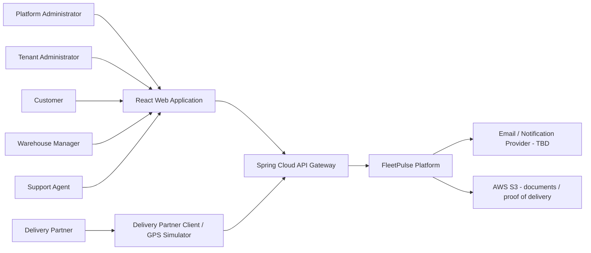
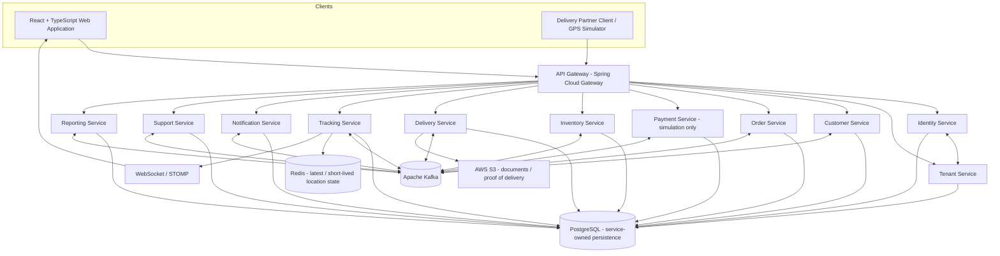
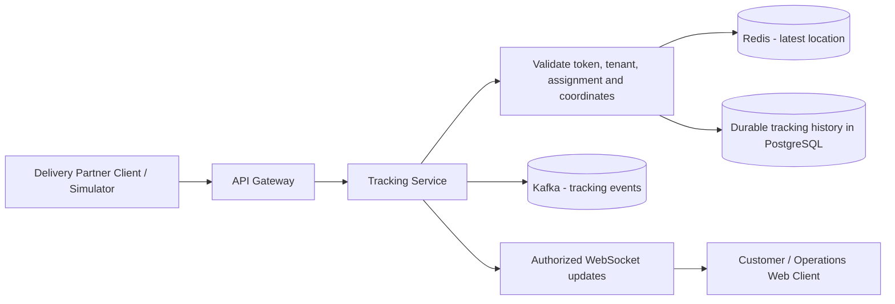
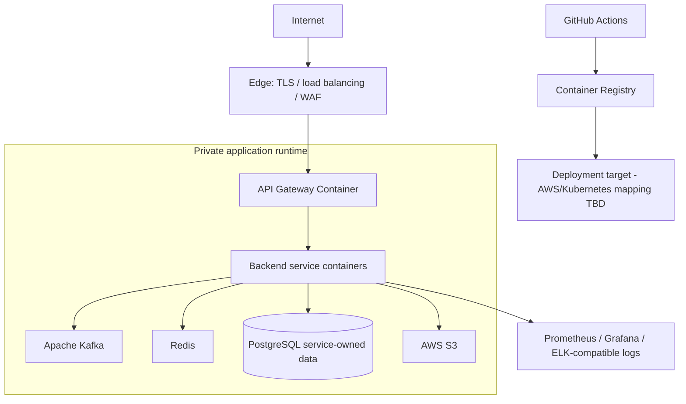

# FleetPulse – Architecture Diagrams

**Status:** Draft – aligned to BRD/SRS v1.0 and HLD v1.0; pending team approval  
**Revision:** 1.1  
**Source documents:** FP-DOC-001 (BRD/SRS), FP-DOC-002 (HLD)

> These diagrams reflect the source documents' proposed logical architecture. They do not freeze service deployment topology, database topology, AWS service mapping, or unresolved workflow decisions.

## 1. System context

The BRD/SRS defines a web interface with desktop and mobile-browser layouts. A native mobile application and real payment processing are out of scope for v1. GPS coordinates are submitted by a delivery partner client application or simulator; an external GPS/maps provider is not specified.

## 2. Logical service architecture

This is a logical view, not a deployment diagram. The HLD lists API Gateway plus Identity, Tenant, Customer, Order, Payment, Inventory, Delivery, Tracking, Notification, Support and Reporting. It does not approve combining these services into larger deployables. Physical database separation versus schemas in a shared PostgreSQL cluster remains open; the diagram therefore shows logical ownership, not a decided number of database instances.

## 3. GPS tracking flow

The HLD proposes Redis for the latest location, durable tracking history, Kafka events and WebSocket updates to authorized clients. GPS interval, history retention and detailed protocol behavior remain open for LLD.

## 4. Deployment view (logical)

Docker is the containerization baseline and Kubernetes is the stated deployment target; exact AWS service mapping and production topology remain unresolved in the HLD.

## 5. Architecture rules

- Every service owns its business capability and persistence; no direct cross-service table access.
- Use REST for immediate request/response and Kafka for asynchronous business events.
- Use WebSocket for authorized real-time tracking/progress updates.
- Resolve tenant context from trusted authentication context; never trust a request-body tenant ID as authority.
- Keep simulated payment separate from real payment settlement, which is out of scope for v1.
- Use the HLD's transactional outbox guidance for critical database changes that must publish events.
