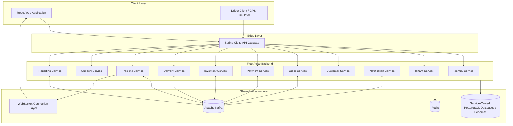
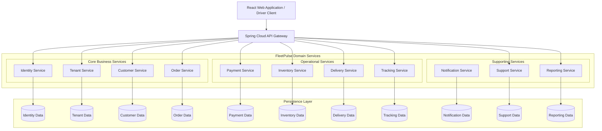
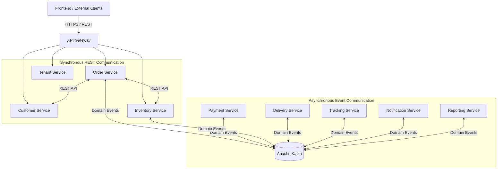
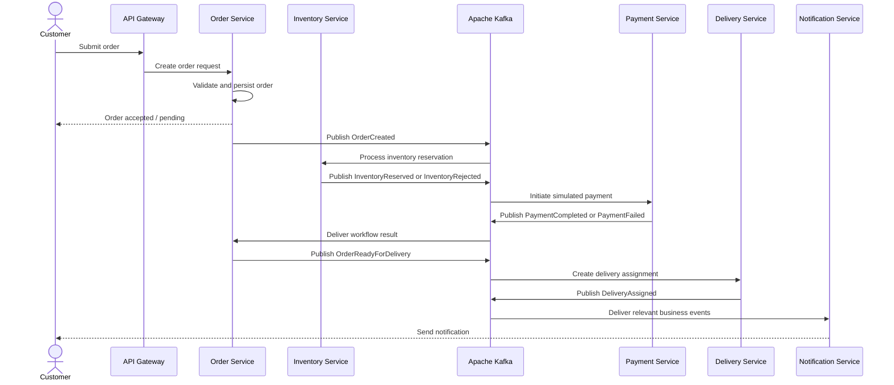
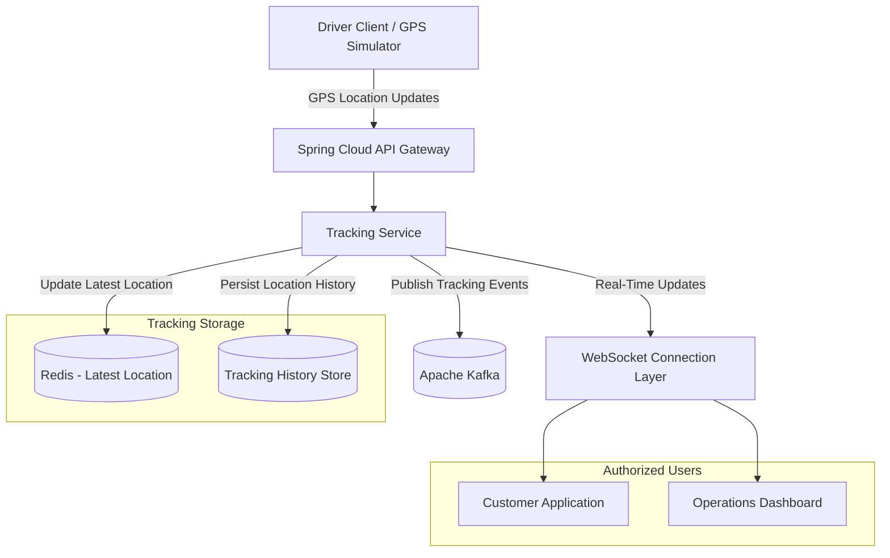
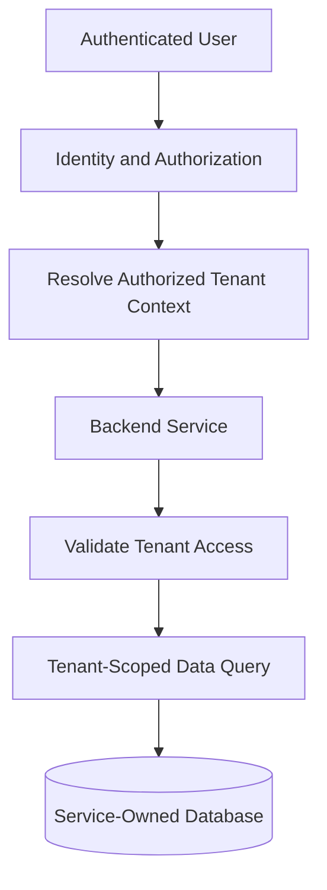
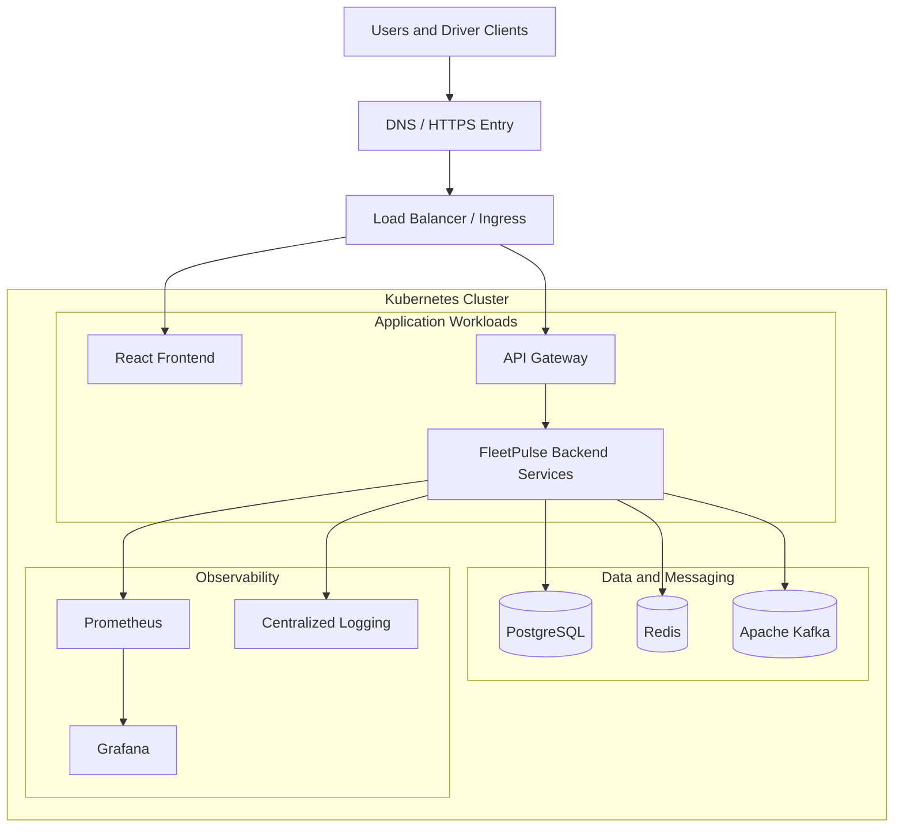
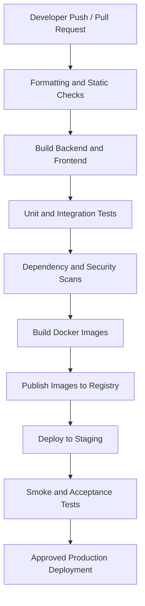

# FleetPulse – Architecture Diagrams

**Document ID:** FP-DOC-003  
**Project:** FleetPulse – Smart Logistics & Real-Time Delivery Management System  
**Version:** 1.0  
**Status:** Draft – Pending Peer Review  
**Prepared:** November 2026  
**Related Document:** FP-DOC-002 – FleetPulse High-Level Design (HLD) v1.0

---

# 1. Document Purpose

This document provides the visual representation of the proposed FleetPulse system architecture.

It translates the architectural concepts described in HLD v1.0 into diagrams covering:

- Overall system architecture.
- Microservices architecture.
- Service communication.
- Order fulfilment workflow.
- Real-time GPS tracking.
- Multi-tenant architecture.
- Deployment architecture.
- CI/CD pipeline.

These diagrams are intended to help developers, reviewers, and stakeholders understand the system structure, service interactions, data flow, and deployment approach.

# 2. Scope

The diagrams in this document represent the proposed logical architecture of FleetPulse.

The architecture follows these principles:

- Domain-oriented microservices.
- API Gateway pattern.
- Synchronous REST communication.
- Asynchronous event-driven communication using Apache Kafka.
- Service-owned data persistence.
- Multi-tenant logical isolation.
- Redis-based caching.
- WebSocket-based real-time tracking.
- Containerized deployment.

**Important:** These diagrams represent the proposed architecture in HLD v1.0. They do not imply that every service must be independently deployed from the first development milestone.

# 3. Overall System Architecture

## 3.1 Description

FleetPulse follows a distributed, domain-oriented architecture.

The React web application and driver client communicate with the backend through the Spring Cloud API Gateway.

The API Gateway acts as the centralized entry point for request routing and cross-cutting request handling.

The backend consists of the following services:

1. Identity Service
2. Tenant Service
3. Customer Service
4. Order Service
5. Payment Service
6. Inventory Service
7. Delivery Service
8. Tracking Service
9. Notification Service
10. Support Service
11. Reporting Service

Services own their business logic and persistence.

Apache Kafka supports asynchronous communication, Redis supports caching and selected short-lived state, and PostgreSQL provides durable relational storage.

## 3.2 Overall Architecture Diagram

## 3.3 Architecture Notes

- The API Gateway provides a centralized entry point for client requests.
- Each backend service owns its business capabilities and persistence model.
- Kafka enables asynchronous event-based communication.
- Redis supports caching and selected short-lived state.
- Tracking Service handles GPS ingestion and real-time location updates.
- WebSocket connections deliver authorized tracking updates to the web application.
- Notification Service processes relevant business events.
- Reporting Service maintains reporting projections rather than directly querying other services' databases.

# 4. Microservices Architecture

## 4.1 Description

FleetPulse is divided into domain-oriented microservices.

Each service is responsible for a specific business capability and owns its corresponding business logic and data.

The service boundaries are logical starting points and will be reviewed against team capacity, domain dependencies, workload, and deployment complexity.

## 4.2 Microservices Architecture Diagram

## 4.3 Service Responsibilities

| Microservice | Primary responsibility |
|---|---|
| Identity Service | User authentication, credentials, roles and permissions |
| Tenant Service | Tenant onboarding, configuration and membership |
| Customer Service | Customer profiles, addresses and preferences |
| Order Service | Order creation, validation and lifecycle management |
| Payment Service | Simulated payments, payment status and refunds |
| Inventory Service | Warehouse stock, reservations and adjustments |
| Delivery Service | Driver assignment and delivery lifecycle |
| Tracking Service | GPS ingestion, location history and live updates |
| Notification Service | Email and in-app notifications |
| Support Service | Support tickets and assignments |
| Reporting Service | Operational reports and aggregated metrics |

## 4.4 Data Ownership Principles

- Each service owns its persistence model.
- No service directly reads or writes another service's database.
- Cross-service data exchange happens through documented APIs or events.
- PostgreSQL is the proposed relational database.
- Flyway manages database schema migrations.
- Reporting uses service-owned read models or event-fed projections.

# 5. Service Communication Architecture

## 5.1 Description

FleetPulse uses two primary communication patterns:

**Synchronous communication – REST**

REST APIs are used when a service requires an immediate response.

Examples include frontend requests, order-related validation, and tenant configuration requests.

**Asynchronous communication – Apache Kafka**

Kafka is used for domain events and asynchronous business workflows.

This approach reduces direct dependencies between services and supports event-driven processing.

## 5.2 Communication Architecture Diagram

**Note:** The REST connections shown between Order, Customer, and Inventory are illustrative communication examples. Exact service-to-service API dependencies must be finalized in the LLD.

## 5.3 Proposed Domain Events

| Event | Producer | Potential Consumers |
|---|---|---|
| OrderCreated | Order | Inventory, Notification, Reporting |
| InventoryReserved | Inventory | Order |
| PaymentCompleted | Payment | Order, Notification, Reporting |
| PaymentFailed | Payment | Order, Notification |
| DeliveryAssigned | Delivery | Tracking, Notification |
| LocationUpdated | Tracking | Reporting or tracking consumers |
| DeliveryCompleted | Delivery | Order, Notification, Reporting |
| TicketCreated | Support | Notification |

## 5.4 Event Processing Considerations

- Every event should contain an event ID.
- Include event type and schema version.
- Include event timestamp.
- Include tenant ID where applicable.
- Consumers must handle duplicate messages safely.
- Configure retry and dead-letter handling.
- Monitor Kafka consumer lag.
- Use the transactional outbox pattern for critical database changes that must publish events.

# 6. Order Fulfilment Workflow

## 6.1 Description

Order fulfilment is one of the central business workflows in FleetPulse.

The Order Service owns the order lifecycle and coordinates the order-related business workflow.

The proposed workflow involves Inventory, Payment, Delivery, Kafka, and Notification services.

The first release uses simulated payment processing and does not process real financial transactions.

## 6.2 Order Fulfilment Sequence Diagram

## 6.3 Workflow Considerations

- Order Service owns order state and valid state transitions.
- Inventory Service manages stock reservation and release.
- Payment Service manages simulated payment status.
- Delivery Service manages delivery assignment and lifecycle.
- Notification Service consumes relevant events.
- Distributed workflow failures must be handled safely.
- Duplicate event processing must not create duplicate business effects.
- Saga orchestration and compensating actions must be finalized during LLD.

**Note:** The diagram represents an illustrative workflow from HLD v1.0. The exact event sequence and failure-handling rules remain subject to detailed design.

# 7. Real-Time GPS Tracking Architecture

## 7.1 Description

Real-time GPS tracking is a core capability of FleetPulse.

Driver clients or GPS simulators send location updates to the Tracking Service through the API Gateway.

The Tracking Service validates the incoming location information and manages the latest location and tracking history.

Redis stores the latest location for fast access, while durable tracking history is persisted according to the tracking storage strategy.

Authorized customers and operations users receive tracking updates through WebSocket connections.

## 7.2 GPS Tracking Architecture Diagram

## 7.3 Tracking Flow

1. Driver client sends GPS location updates.
2. API Gateway receives the authenticated request.
3. Tracking Service validates driver assignment and tenant context.
4. Latest location is updated in Redis.
5. Location history is persisted according to the storage strategy.
6. Relevant tracking events are published to Kafka.
7. Authorized users receive updates through WebSocket.

## 7.4 Tracking Considerations

- Validate latitude and longitude.
- Validate timestamps and driver assignment.
- Reject unauthorized or stale location updates according to defined rules.
- Restrict tracking visibility to authorized users.
- Enforce tenant isolation.
- Define GPS update frequency and rate limits.
- Define location retention and archival policies.
- Monitor GPS ingestion and update delivery latency.

The HLD proposes a GPS update visibility P95 target below five seconds under normal test conditions. This is a proposed test target, not a guaranteed production SLA.

# 8. Multi-Tenant Architecture

## 8.1 Description

FleetPulse follows a multi-tenant SaaS architecture.

The initial release proposes shared application infrastructure with logical tenant isolation.

Tenant-owned records are associated with a tenant identifier.

Tenant context must be established from a trusted authentication and authorization context.

A tenant ID supplied only through a request body or query parameter must never be trusted.

## 8.2 Tenant Isolation Diagram

## 8.3 Tenant Request Processing

1. Validate the access token.
2. Resolve the authenticated user.
3. Resolve authorized tenant membership.
4. Establish tenant context.
5. Validate tenant access in the service.
6. Execute tenant-scoped data queries.
7. Propagate tenant context in relevant events.

## 8.4 Tenant Isolation Controls

- Tenant-aware repository queries.
- Tenant-aware authorization checks.
- Tenant-scoped unique constraints.
- Cross-tenant access tests.
- Tenant context propagation.
- Tenant-aware audit logs.
- Restricted reporting access.
- Different authorization scopes for platform administrators and tenant administrators.

# 9. Deployment Architecture

## 9.1 Description

FleetPulse will use Docker for application containerization.

Kubernetes is the proposed target container orchestration platform.

The development environment should remain lightweight, while staging and production environments should support the required operational capabilities.

The proposed environments are:

| Environment | Purpose |
|---|---|
| Local | Developer workstation and Docker Compose |
| Development | Shared integration environment |
| Staging | Production-like testing |
| Production | Live SaaS platform |

## 9.2 Deployment Architecture Diagram

## 9.3 Deployment Considerations

- Externalize application configuration.
- Store secrets securely.
- Configure resource requests and limits.
- Configure readiness and liveness probes.
- Support rolling deployments.
- Define database backup and recovery procedures.
- Separate production and non-production credentials.
- Consider managed database and messaging services where operationally beneficial.

The final AWS service mapping and Kubernetes topology will be covered in the infrastructure design document.

# 10. CI/CD Pipeline Architecture

## 10.1 Description

FleetPulse proposes GitHub Actions for automating the build, testing, security checks, and deployment pipeline.

Code changes are validated before they are promoted to subsequent environments.

Production deployment requires appropriate approval.

## 10.2 CI/CD Pipeline Diagram

## 10.3 Pipeline Requirements

- Pull requests must pass required checks.
- Main branch must remain deployable.
- Docker images should be versioned.
- Database migrations must be reviewed.
- Production deployments must require appropriate approval.
- Build artifacts and deployment versions must be traceable.

# 11. Architecture-Wide Design Considerations

The following principles apply across the diagrams and proposed system architecture.

## 11.1 Security

- Use Spring Security and OAuth2 Resource Server-compatible JWT validation.
- Enforce tenant-aware authorization.
- Apply secure service-to-service authentication.
- Use HTTPS/TLS for external communication.
- Protect secrets and sensitive information.
- Maintain audit logging.

## 11.2 Resilience

- Configure request and connection timeouts.
- Use bounded retries with backoff.
- Apply circuit breakers where appropriate.
- Implement idempotent event consumers.
- Configure dead-letter handling.
- Monitor service health and Kafka consumer lag.
- Define workflow recovery procedures.

## 11.3 Observability

- Use Prometheus for metrics collection.
- Use Grafana for dashboards.
- Use structured logs.
- Propagate correlation IDs and trace IDs.
- Monitor request latency, error rates, JVM metrics, database connections, and Kafka consumer lag.
- Monitor GPS ingestion and tracking update latency.

## 11.4 Scalability

- Prefer stateless request handling.
- Scale services based on measured workloads.
- Optimize database queries and indexes.
- Use pagination for large datasets.
- Use Kafka partitioning according to event workload and ordering requirements.
- Optimize GPS ingestion and retention strategies.

# 12. Relationship with Other Design Documents

This document complements the following FleetPulse documentation:

| Document | Purpose |
|---|---|
| BRD & SRS v1.0 | Business requirements and functional requirements |
| HLD v1.0 | High-level system architecture and design decisions |
| Microservices Design | Detailed service responsibilities and boundaries |
| Communication Design | REST APIs and Kafka event communication |
| Infrastructure Design | Infrastructure and deployment details |
| Database Design | Database structure and relationships |
| API Specification | API endpoints and request/response contracts |
| Event Catalog | Event schemas and message definitions |

# 13. Review and Approval

This document is a visual representation of the proposed FleetPulse architecture.

The diagrams must be reviewed against HLD v1.0 before being approved.

| Role | Name | Status |
|---|---|---|
| Project Owner | TBD | Pending |
| Technical Reviewer | TBD | Pending |
| Team Member | TBD | Pending |

---

**End of Document**

**Document ID:** FP-DOC-003  
**Document:** FleetPulse – Architecture Diagrams  
**Version:** 1.0  
**Status:** Draft – Pending Peer Review