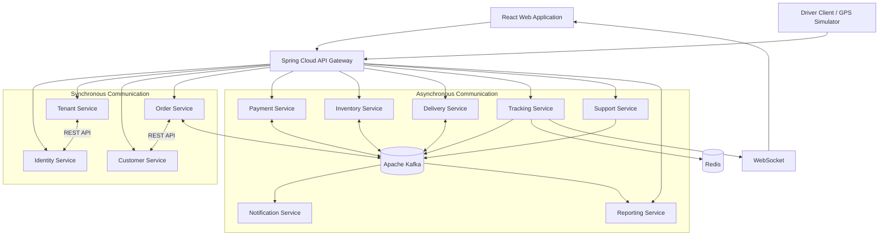
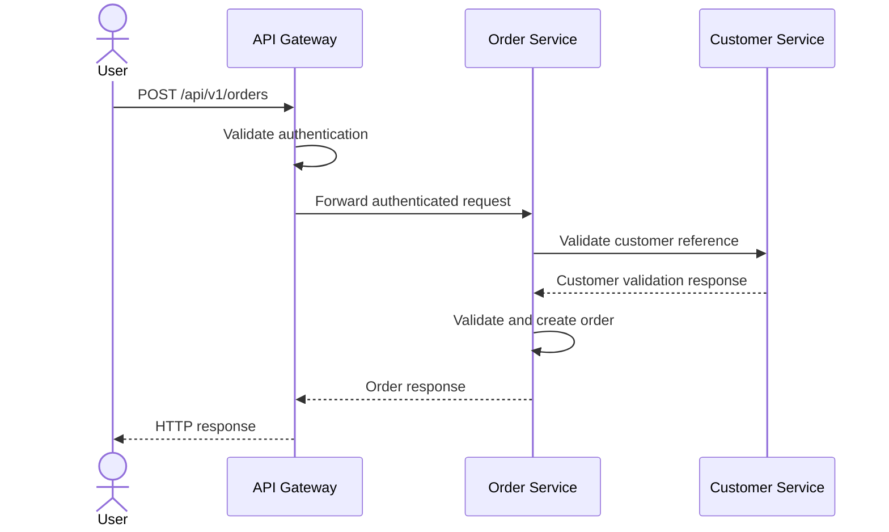
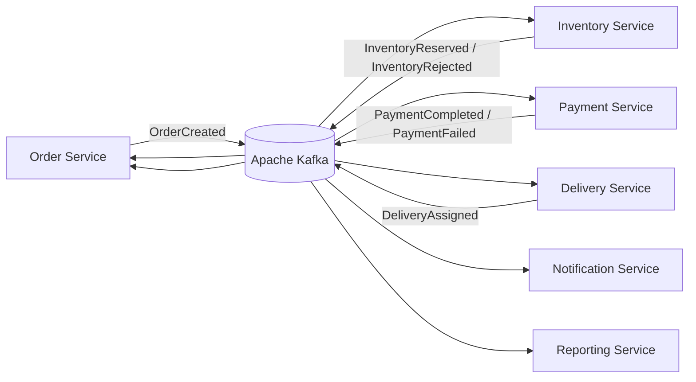
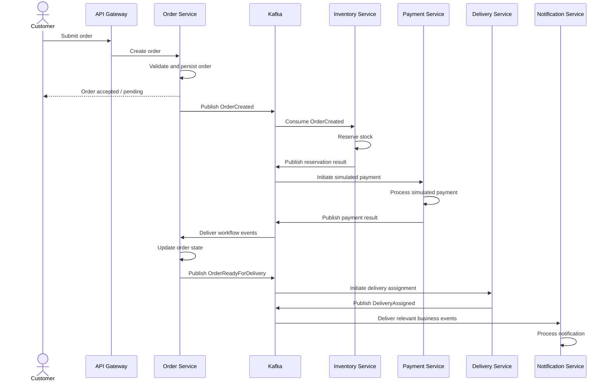
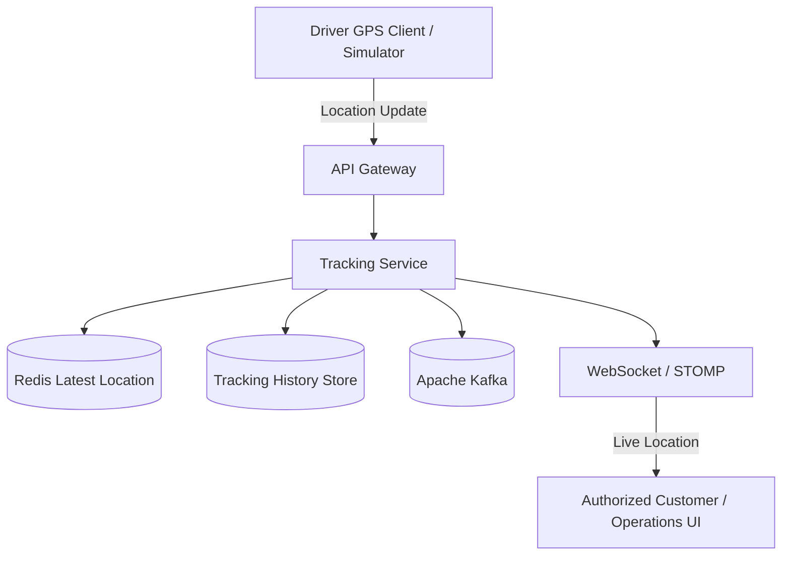
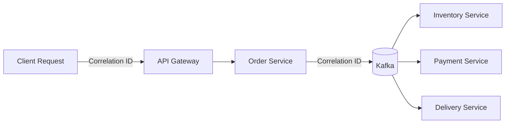

# FleetPulse – Communication Design

**Document ID:** FP-DOC-005  
**Project:** FleetPulse – Smart Logistics & Real-Time Delivery Management System  
**Version:** 1.0  
**Status:** Draft – Pending Peer Review  
**Prepared:** November 2026  
**Related Document:** FP-DOC-002 – FleetPulse High-Level Design v1.0

---

# 1. Document Purpose

This document defines how FleetPulse microservices communicate with each other and with external clients.

It establishes the proposed communication standards for:

- Synchronous REST API communication.
- Asynchronous Kafka messaging.
- Event producers and consumers.
- Real-time GPS tracking using WebSocket.
- API security and tenant context propagation.
- Error handling and retry mechanisms.
- Correlation IDs and distributed tracing.
- Communication reliability and monitoring.

This document provides the foundation for the detailed API specification and event catalogue during Low-Level Design (LLD).

# 2. Communication Architecture Overview

FleetPulse uses three primary communication mechanisms.

| Communication mechanism | Purpose | Technology |
|---|---|---|
| Synchronous | Immediate request and response | REST APIs |
| Asynchronous | Domain events and background processing | Apache Kafka |
| Real-time | Live tracking updates | WebSocket / STOMP |

Spring Cloud Gateway acts as the centralized entry point for client-facing HTTP requests.

Backend services communicate directly through authorized REST APIs when an immediate response is required, or through Kafka when asynchronous processing is more appropriate.

## 2.1 Communication Architecture Diagram



**Note:** The diagram represents proposed communication patterns. Exact REST dependencies and event subscriptions will be finalized during LLD.

# 3. Synchronous Communication – REST APIs

## 3.1 Overview

REST APIs are used when a service requires an immediate response from another service.

For example:

1. A customer submits an order.
2. API Gateway routes the request to Order Service.
3. Order Service validates the request.
4. If required, Order Service requests customer information through an authorized API.
5. Order Service returns the appropriate response.

REST communication will use HTTP and JSON.

## 3.2 REST Communication Flow



## 3.3 Proposed API Conventions

| Item | Proposed standard |
|---|---|
| Protocol | HTTPS |
| Data format | JSON |
| API style | REST |
| API versioning | URL-based versioning |
| Version example | `/api/v1/orders` |
| Authentication | JWT / OAuth2-compatible |
| Content type | `application/json` |
| Time standard | UTC timestamps |
| Documentation | OpenAPI / Swagger |

These conventions will be reviewed and finalized before implementation.

## 3.4 HTTP Methods

| HTTP Method | Purpose | Example |
|---|---|---|
| GET | Retrieve information | Get order details |
| POST | Create a resource or initiate an operation | Create order |
| PUT | Replace a resource | Update customer profile |
| PATCH | Partially update a resource | Update delivery status |
| DELETE | Delete an eligible resource | Remove an address |

Actual endpoint methods and paths will be defined in the API specification.

## 3.5 HTTP Response Status Codes

| Status Code | Meaning | Example |
|---|---|---|
| 200 | OK | Successful request |
| 201 | Created | Order successfully created |
| 202 | Accepted | Request accepted for asynchronous processing |
| 400 | Bad Request | Invalid request data |
| 401 | Unauthorized | Missing or invalid authentication |
| 403 | Forbidden | Insufficient permissions |
| 404 | Not Found | Order or customer not found |
| 409 | Conflict | Invalid state transition or duplicate operation |
| 422 | Unprocessable Entity | Business validation failure |
| 500 | Internal Server Error | Unexpected server error |
| 503 | Service Unavailable | Service temporarily unavailable |

## 3.6 REST Communication Best Practices

Every service should follow these practices:

- Validate incoming request data.
- Use consistent response structures.
- Configure connection and request timeouts.
- Propagate correlation IDs.
- Enforce authentication and authorization.
- Apply tenant-aware access validation.
- Use appropriate API versioning.
- Avoid exposing internal stack traces.
- Apply retries only where safe.
- Avoid blindly retrying non-idempotent operations.

# 4. Asynchronous Communication – Apache Kafka

## 4.1 Overview

Apache Kafka will support event-driven communication between FleetPulse microservices.

Kafka allows a producer service to publish an event without requiring all consumers to process it immediately.

Other services can consume the event independently.

For example:

- Order Service publishes `OrderCreated`.
- Inventory Service consumes the event.
- Inventory Service processes stock reservation.
- Inventory Service publishes `InventoryReserved` or `InventoryRejected`.
- Order Service consumes the result and updates the order workflow.

This reduces direct runtime dependencies between services.

## 4.2 Kafka Communication Flow



## 4.3 Event Producers and Consumers

A producer publishes an event to Kafka.

A consumer subscribes to the relevant event or topic and processes it.

| Event | Producer | Potential consumers |
|---|---|---|
| OrderCreated | Order Service | Inventory, Notification, Reporting |
| InventoryReserved | Inventory Service | Order Service |
| InventoryRejected | Inventory Service | Order Service |
| PaymentCompleted | Payment Service | Order, Notification, Reporting |
| PaymentFailed | Payment Service | Order, Notification |
| DeliveryAssigned | Delivery Service | Tracking, Notification |
| LocationUpdated | Tracking Service | Reporting or tracking consumers |
| DeliveryCompleted | Delivery Service | Order, Notification, Reporting |
| TicketCreated | Support Service | Notification Service |

**Important:** These event names and consumer relationships are proposed examples. The final event catalogue will define the authoritative event contracts.

## 4.4 Proposed Kafka Topic Naming Convention

A consistent naming convention will make Kafka topics easier to maintain.

Proposed format:

`fleetpulse.<domain>.<event-name>`

Examples:

| Topic | Purpose |
|---|---|
| `fleetpulse.order.created` | New order created |
| `fleetpulse.inventory.reserved` | Inventory reservation completed |
| `fleetpulse.inventory.rejected` | Inventory reservation rejected |
| `fleetpulse.payment.completed` | Simulated payment completed |
| `fleetpulse.payment.failed` | Simulated payment failed |
| `fleetpulse.delivery.assigned` | Driver assigned to delivery |
| `fleetpulse.tracking.location-updated` | Driver location updated |
| `fleetpulse.delivery.completed` | Delivery completed |
| `fleetpulse.support.ticket-created` | New support ticket created |

Topic naming, partitioning, retention, and consumer-group configuration must be finalized during infrastructure and event design.

# 5. Event Message Structure

Kafka events should follow a consistent message structure.

## 5.1 Proposed Event Envelope

```json
{
  "eventId": "event-uuid",
  "eventType": "OrderCreated",
  "eventVersion": 1,
  "occurredAt": "2026-11-22T12:00:00Z",
  "correlationId": "correlation-uuid",
  "tenantId": "tenant-123",
  "producer": "order-service",
  "payload": {
    "orderId": "order-1001",
    "customerId": "customer-101",
    "orderStatus": "PENDING"
  }
}
```

The values above are illustrative examples, not actual FleetPulse records.

## 5.2 Event Field Description

| Field | Description |
|---|---|
| eventId | Unique identifier for the event |
| eventType | Business event name |
| eventVersion | Event schema version |
| occurredAt | Event creation timestamp in UTC |
| correlationId | Identifier connecting related operations |
| tenantId | Authorized tenant context |
| producer | Service publishing the event |
| payload | Business data associated with the event |

## 5.3 Event Design Principles

- Every event should have a unique event ID.
- Event schemas must be versioned.
- Events should contain only necessary business information.
- Consumers must validate incoming messages.
- Sensitive information must not be unnecessarily published.
- Tenant context must be preserved and validated.
- Event contracts must remain backward-compatible where possible.

# 6. Order Fulfilment Communication Workflow

Order fulfilment is a major business workflow in FleetPulse.

It involves multiple services communicating through Kafka.

## 6.1 Proposed Workflow

1. Customer submits an order.
2. API Gateway forwards the request to Order Service.
3. Order Service validates and stores the order.
4. Order Service publishes `OrderCreated`.
5. Inventory Service consumes the event and attempts stock reservation.
6. Inventory Service publishes its reservation result.
7. Payment Service performs simulated payment processing.
8. Payment Service publishes payment status.
9. Order Service processes the workflow result.
10. When the order is ready for delivery, the workflow initiates delivery assignment.
11. Delivery Service publishes `DeliveryAssigned`.
12. Notification Service consumes relevant events and sends notifications.

The exact orchestration, failure handling, and state transitions must be finalized during LLD.

## 6.2 Sequence Diagram



# 7. Real-Time Communication – WebSocket

## 7.1 Overview

FleetPulse requires real-time GPS tracking for delivery operations.

WebSocket will support live communication between the backend tracking capability and authorized frontend clients.

Unlike normal HTTP request-response communication, WebSocket provides a persistent, two-way connection.

## 7.2 Tracking Communication Flow

1. Driver client or GPS simulator submits a location update.
2. API Gateway validates authentication and routes the request.
3. Tracking Service validates driver assignment and tenant context.
4. Tracking Service updates the latest location in Redis.
5. Tracking history is persisted according to the storage strategy.
6. Tracking Service publishes relevant Kafka events.
7. Authorized customer and operations clients receive updates through WebSocket.

## 7.3 Tracking Diagram



## 7.4 WebSocket Security

- Only authenticated clients may establish authorized connections.
- Users must only subscribe to deliveries they are permitted to access.
- Tenant isolation must be enforced.
- Unauthorized subscriptions must be rejected.
- Sensitive location information must not be exposed to unrelated users.

The exact WebSocket endpoint, subscription destinations, and STOMP message contracts will be documented during LLD.

# 8. Communication Security

All communication must follow the FleetPulse security architecture.

## 8.1 REST Security

- Use HTTPS for external communication.
- Validate JWT authentication.
- Apply role-based authorization.
- Validate tenant context.
- Protect internal service endpoints.
- Avoid exposing sensitive information in responses.

## 8.2 Kafka Security

- Restrict producer and consumer access.
- Apply topic-level authorization.
- Validate event structure.
- Avoid publishing credentials and secrets.
- Preserve tenant context.
- Protect Kafka infrastructure and credentials.

## 8.3 WebSocket Security

- Authenticate WebSocket connections.
- Authorize subscriptions.
- Validate tenant and delivery access.
- Protect location data.
- Apply appropriate connection controls.

# 9. Error Handling and Retry Strategy

Distributed communication can fail because of network issues, unavailable services, processing errors, or infrastructure problems.

FleetPulse must handle these failures safely.

## 9.1 REST Error Handling

Proposed controls:

- Connection timeouts.
- Request timeouts.
- Consistent HTTP error responses.
- Bounded retries with exponential backoff where appropriate.
- Circuit breakers for selected remote dependencies.
- Idempotency controls for operations that may be retried.

Non-idempotent requests must not be blindly retried.

## 9.2 Kafka Error Handling

Proposed controls:

- Consumer retry handling.
- Idempotent message processing.
- Dead-letter topic handling for messages that cannot be processed.
- Duplicate event detection.
- Consumer lag monitoring.
- Safe recovery and replay procedures.

Kafka delivery and processing guarantees must be configured and tested rather than assumed.

## 9.3 Communication Failure Scenarios

| Scenario | Proposed handling |
|---|---|
| REST service unavailable | Timeout and controlled retry where safe |
| Invalid API request | Return appropriate 4xx response |
| Kafka consumer failure | Retry according to configured policy |
| Duplicate event | Detect and avoid repeating business effects |
| Invalid event schema | Reject or route to appropriate failure handling |
| Notification provider failure | Retry notification delivery |
| WebSocket disconnection | Allow authorized reconnection |
| Database unavailable | Fail safely and expose service health status |

Critical workflow recovery and compensation must be defined during LLD.

# 10. Correlation ID and Distributed Tracing

A single business operation may involve multiple microservices.

For example, an order may pass through Order, Inventory, Payment, Delivery, and Notification services.

Correlation IDs help identify all related operations.

## 10.1 Correlation Flow



## 10.2 Logging Standards

Structured logs should contain:

- Timestamp.
- Service name.
- Environment.
- Correlation ID.
- Trace ID where available.
- Tenant ID where appropriate and safe.
- Error classification.
- Relevant business identifier where appropriate.

Passwords, access tokens, payment secrets, and unnecessary personal information must never be logged.

Distributed tracing should be introduced to follow requests across service boundaries.

# 11. Communication Monitoring

FleetPulse must monitor communication health across the platform.

## 11.1 REST Metrics

- Request count.
- Response time.
- Error rate.
- HTTP status codes.
- Timeout count.
- Service availability.

## 11.2 Kafka Metrics

- Messages produced.
- Messages consumed.
- Consumer lag.
- Processing failures.
- Retry count.
- Dead-letter message count.
- Topic throughput.

## 11.3 WebSocket Metrics

- Active connections.
- Connection failures.
- Reconnection count.
- Message delivery latency.
- Unauthorized subscription attempts.

## 11.4 Monitoring Technologies

| Technology | Purpose |
|---|---|
| Prometheus | Metrics collection |
| Grafana | Monitoring dashboards |
| Structured logging / ELK-compatible stack | Centralized log analysis |
| Distributed tracing | Cross-service request visibility |

# 12. Open Design Decisions

The following items require team review and detailed design:

1. What will be the final REST endpoint naming convention?
2. Which REST APIs will be synchronous service-to-service dependencies?
3. What Kafka topic partitioning strategy should be used?
4. Which Kafka event schema and versioning approach should be adopted?
5. What retry and dead-letter policies should be configured?
6. How should event ordering be maintained for order-related workflows?
7. Should transactional outbox be implemented for reliable event publication?
8. Which service will orchestrate the order fulfilment Saga?
9. What WebSocket endpoint and subscription structure should be used?
10. What are the initial communication performance targets?

These decisions must be reviewed before implementation and recorded where appropriate.

# 13. Related Documents

| Document | Purpose |
|---|---|
| FP-DOC-001 | Business Requirements Document and Software Requirements Specification |
| FP-DOC-002 | High-Level Design |
| FP-DOC-003 | Architecture Diagrams |
| FP-DOC-004 | Microservices Design |
| FP-DOC-006 | Infrastructure Design |
| Future LLD | API Specification, Event Catalogue, Sequence Diagrams, Database Design |

# 14. Review and Approval

| Role | Name | Status | Date |
|---|---|---|---|
| Project Owner | TBD | Pending | TBD |
| Technical Reviewer | TBD | Pending | TBD |
| Team Member | TBD | Pending | TBD |

---

**End of Document**

**Document:** FP-DOC-005 – FleetPulse Communication Design  
**Version:** 1.0  
**Status:** Draft – Pending Peer Review