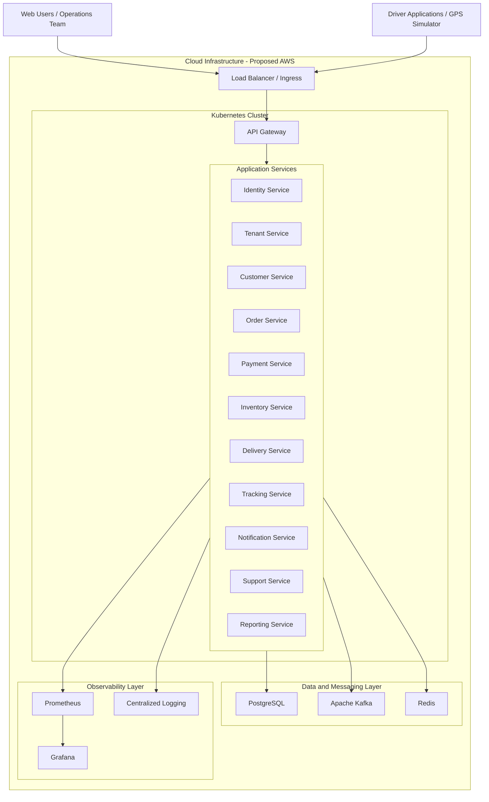
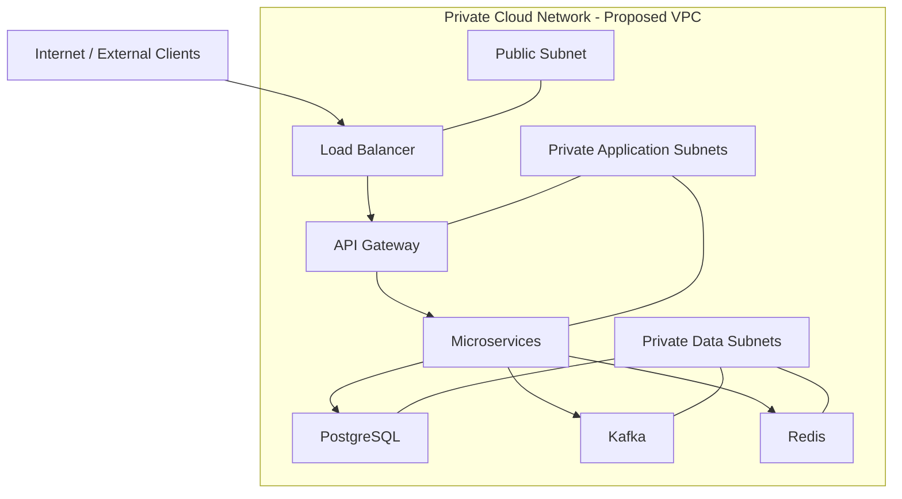
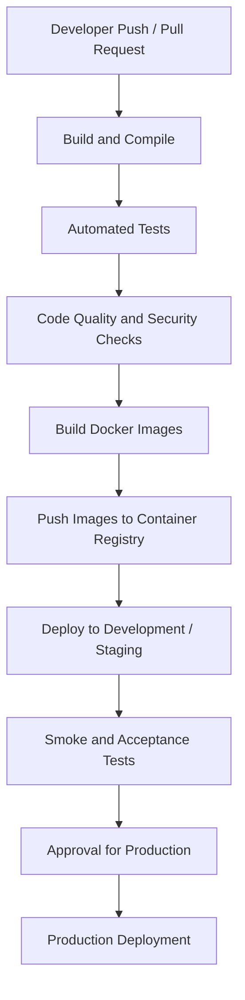

# FleetPulse – Infrastructure Design

**Document ID:** FP-DOC-006  
**Version:** 1.0  
**Status:** Draft – Pending Team Review  
**Prepared:** November 2026  
**Related Documents:**
- FP-DOC-001 – FleetPulse BRD & SRS v1.0
- FP-DOC-002 – FleetPulse High-Level Design (HLD) v1.0
- FP-DOC-003 – Architecture Diagrams
- FP-DOC-004 – Microservices Design
- FP-DOC-005 – Communication Design

---

## 1. Purpose

This document describes the proposed infrastructure architecture required to deploy, operate, monitor, and scale the FleetPulse platform.

It covers:

- Deployment environments
- Containerization and orchestration
- Cloud infrastructure direction
- Network and security architecture
- Database, messaging, and caching infrastructure
- Configuration and secrets management
- Monitoring and logging
- Backup and disaster recovery
- CI/CD infrastructure
- Scalability and reliability considerations

This document defines the proposed infrastructure direction. Final cloud services, resource sizing, networking details, and deployment configurations will be confirmed during Low-Level Design (LLD) and implementation.

## 2. Infrastructure Overview

FleetPulse is designed as a cloud-ready, containerized, multi-tenant SaaS platform.

The proposed infrastructure uses:

| Component | Technology / Direction |
|---|---|
| Cloud platform | AWS – proposed target |
| Application runtime | Docker containers |
| Container orchestration | Kubernetes |
| Backend services | Java 21, Spring Boot |
| Frontend | React, TypeScript, Vite |
| API entry point | Spring Cloud Gateway |
| Relational database | PostgreSQL |
| Message broker | Apache Kafka |
| Cache / latest GPS data | Redis |
| Real-time communication | WebSocket |
| CI/CD | GitHub Actions |
| Monitoring | Prometheus and Grafana |
| Logging | ELK-compatible centralized logging |
| API documentation | OpenAPI / Swagger |

The infrastructure must support independent service deployment, secure tenant isolation, horizontal scaling, and reliable communication between services.

## 3. High-Level Infrastructure Architecture

The following diagram illustrates the proposed infrastructure deployment model.

**Design notes:**
- External traffic enters through the load-balancing and ingress layer.
- API Gateway acts as the central application entry point.
- Backend services run as independently deployable containers.
- PostgreSQL, Kafka, and Redis provide persistence, asynchronous messaging, and caching.
- Monitoring and logging collect operational information from the application environment.
- The diagram represents logical infrastructure components. Exact AWS service mapping is pending review.

## 4. Deployment Environments

FleetPulse will use separate environments to support development, testing, and production deployment.

| Environment | Purpose | Proposed Setup |
|---|---|---|
| Local | Individual development and debugging | Docker Compose |
| Development | Integration of developer changes | Shared development infrastructure |
| Staging | Pre-production validation | Production-like environment |
| Production | Live platform deployment | Cloud infrastructure with Kubernetes |

### 4.1 Local Environment

The local environment will allow developers to run and test services on their machines.

Proposed components:

- Docker and Docker Compose
- Spring Boot microservices
- PostgreSQL
- Apache Kafka
- Redis
- React frontend
- Supporting development tools

The local environment should make it possible to test service communication without requiring a full cloud deployment.

### 4.2 Development Environment

The development environment will be used for integrating individual service implementations.

It should support:
- Integration testing between services
- Kafka event testing
- Database connectivity testing
- API testing
- Basic application monitoring

### 4.3 Staging Environment

Staging will provide a production-like environment for validating application releases.

Expected activities:
- End-to-end testing
- Deployment verification
- Smoke testing
- Performance and reliability checks
- Configuration validation

### 4.4 Production Environment

Production will host the live FleetPulse platform.

It must provide:
- Secure external access
- High availability where required
- Controlled application deployments
- Centralized monitoring and logging
- Backup and recovery capabilities
- Resource scaling based on workload

## 5. Containerization and Orchestration

### 5.1 Docker

Docker will be used to package FleetPulse services and their runtime dependencies into containers.

Each backend microservice should have its own Docker image.

Benefits:
- Consistent runtime across environments
- Simplified deployment
- Service isolation
- Easier version management
- Reproducible application environments

### 5.2 Kubernetes

Kubernetes is the proposed orchestration platform for cloud deployment.

It will manage:
- Container scheduling
- Service discovery
- Application scaling
- Health checks
- Rolling deployments
- Container restart and recovery
- Resource allocation

Each microservice should be deployable independently.

The final Kubernetes deployment structure, namespaces, resource limits, and scaling policies will be defined during LLD.

## 6. Cloud Infrastructure – AWS Direction

AWS is the proposed cloud platform for FleetPulse.

The following are candidate infrastructure mappings, not finalized decisions.

| Infrastructure Requirement | Candidate AWS Service |
|---|---|
| Kubernetes management | Amazon EKS |
| Container image registry | Amazon ECR |
| Load balancing | Elastic Load Balancing |
| Relational database | Amazon RDS for PostgreSQL |
| Kafka infrastructure | Amazon MSK |
| Redis infrastructure | Amazon ElastiCache |
| Object storage | Amazon S3 |
| Secrets management | AWS Secrets Manager |
| Application configuration | AWS Systems Manager Parameter Store |
| Monitoring | Amazon CloudWatch |
| Network isolation | Amazon VPC |

The team will evaluate managed services against cost, operational complexity, scalability, and learning requirements before selecting the final infrastructure.

## 7. Network Architecture

The infrastructure should use a secure network design that separates public access from internal application and data components.

Proposed network structure:

**Network security principles:**
- Only required external endpoints should be publicly accessible.
- Databases, Kafka, and Redis should not be directly exposed to the public internet.
- Internal services should communicate through approved network paths.
- Network access should follow the principle of least privilege.
- TLS should be used for external communication and appropriate internal communication.
- Administrative access should be restricted and audited.

The exact subnet design, firewall rules, routing, and network policies will be finalized during LLD.

## 8. Database, Messaging, and Cache Infrastructure

### 8.1 PostgreSQL

PostgreSQL will provide durable relational storage.

Infrastructure considerations:
- Persistent storage
- Connection limits and connection pooling
- Backup scheduling
- Database monitoring
- Restricted network access
- Database migration management using Flyway

Each microservice logically owns its business data. The physical database and schema deployment strategy remains an open design decision.

### 8.2 Apache Kafka

Kafka will support asynchronous communication between services.

Infrastructure considerations:
- Broker availability
- Topic configuration
- Partition strategy
- Replication strategy
- Consumer group monitoring
- Message retention
- Dead-letter topic handling

Topic names and broker configuration will be finalized during LLD.

### 8.3 Redis

Redis will support caching and fast access to frequently requested data, including the latest GPS location.

Infrastructure considerations:
- Memory monitoring
- Expiration policies
- Access restrictions
- Persistence requirements where applicable
- High availability requirements

Redis will not replace PostgreSQL as the primary durable relational data store.

## 9. Configuration and Secrets Management

Application configuration must be separated from application code.

Examples of configuration:
- Database connection settings
- Kafka broker addresses
- Redis connection settings
- Service URLs
- Environment-specific feature settings

Sensitive information includes:
- Database passwords
- JWT signing or verification secrets where applicable
- External provider credentials
- API keys
- Other authentication credentials

Security requirements:
- Never commit secrets to GitHub.
- Use environment-specific configuration.
- Restrict access to sensitive values.
- Rotate credentials when required.
- Avoid printing secrets in application logs.
- Use a managed secrets solution in cloud environments where appropriate.

## 10. Monitoring and Logging Infrastructure

FleetPulse will use centralized observability to monitor service health and investigate production issues.

### 10.1 Metrics

Prometheus will collect application and infrastructure metrics.

Grafana will provide dashboards for monitoring.

Important metrics include:
- HTTP request rate
- HTTP error rate
- API response latency
- JVM memory and garbage collection
- CPU and memory utilization
- Database connection pool usage
- Kafka consumer lag
- GPS ingestion latency
- WebSocket connection count
- Order processing failures

### 10.2 Logging

Services should generate structured logs that can be collected centrally.

Recommended log fields:
- Timestamp
- Service name
- Environment
- Log level
- Correlation ID
- Trace ID
- Tenant identifier where appropriate
- Error classification

Sensitive information such as passwords, access tokens, payment credentials, and unnecessary personal data must never be logged.

### 10.3 Alerting

Alerts should be considered for:
- Service health-check failures
- High API error rates
- Increased response latency
- High CPU or memory usage
- Database connectivity failures
- Kafka consumer lag
- GPS processing delays

Alert thresholds and notification channels will be defined during implementation and operational testing.

## 11. CI/CD Infrastructure

GitHub Actions will be used as the proposed CI/CD platform.

The deployment pipeline will follow this general flow:

Pipeline responsibilities:
- Compile Java services
- Execute automated tests
- Perform code quality checks
- Run applicable security checks
- Build versioned Docker images
- Publish images to a container registry
- Deploy to the target environment
- Validate deployments through smoke tests

Production deployment should use an approved release process.

## 12. Scalability and Reliability

The infrastructure should support growth in users, orders, and GPS tracking activity.

### 12.1 Scalability

Proposed approaches:
- Horizontal scaling of backend services
- Kubernetes resource management
- Independent scaling of high-traffic services
- Database connection pool management
- Kafka partitioning based on workload
- Redis for frequently accessed data
- Monitoring resource utilization

Tracking and order-processing workloads may require different scaling strategies.

### 12.2 Reliability

The infrastructure and application design should support:
- Health checks and readiness checks
- Automatic container restart where appropriate
- Controlled rolling deployments
- Timeouts and bounded retries
- Circuit breakers where appropriate
- Idempotent Kafka consumers
- Dead-letter handling
- Graceful application shutdown

These controls should be validated through integration and failure testing.

## 13. Backup and Disaster Recovery

Backup and recovery requirements must be established before production deployment.

Areas to define:
- PostgreSQL backup frequency
- Backup retention period
- Database restoration procedure
- Kafka recovery requirements
- Redis recovery expectations
- Configuration and secrets recovery
- Infrastructure redeployment procedure

The team must agree on:

- **RPO (Recovery Point Objective):** Maximum acceptable data loss measured in time.
- **RTO (Recovery Time Objective):** Maximum acceptable time to restore the service.

Actual RPO and RTO targets are open decisions and must not be assumed until agreed by the team.

## 14. Security Considerations

Infrastructure security must follow a defense-in-depth approach.

Key requirements:
- HTTPS for external application traffic
- Restricted access to internal services
- Private access to data infrastructure
- Least-privilege access permissions
- Secure secret storage
- Container image security checks
- Dependency vulnerability scanning
- Controlled administrative access
- Centralized audit and operational logging
- Tenant isolation enforced by application authorization

Infrastructure-level isolation complements, but does not replace, application-level tenant authorization.

## 15. Open Design Decisions

The following items require team discussion and approval.

| # | Decision | Current Status |
|---|---|---|
| 1 | Final AWS service selection | Pending |
| 2 | EKS versus alternative deployment approach | Pending |
| 3 | Managed versus self-managed PostgreSQL | Pending |
| 4 | Kafka hosting and configuration | Pending |
| 5 | Redis hosting and persistence strategy | Pending |
| 6 | Database-per-service versus schema-per-service deployment | Pending |
| 7 | Network topology and subnet design | Pending |
| 8 | Environment resource sizing | Pending |
| 9 | Backup retention and recovery targets | Pending |
| 10 | Monitoring and alert notification channels | Pending |
| 11 | Production deployment approval process | Pending |
| 12 | Infrastructure cost estimates | Pending |

These decisions should be finalized before production infrastructure is provisioned.

## 16. Related Documents

| Document ID | Document Name |
|---|---|
| FP-DOC-001 | FleetPulse BRD & SRS v1.0 |
| FP-DOC-002 | FleetPulse High-Level Design v1.0 |
| FP-DOC-003 | Architecture Diagrams |
| FP-DOC-004 | Microservices Design |
| FP-DOC-005 | Communication Design |
| FP-DOC-006 | Infrastructure Design |

## 17. Review and Approval

**Document Status:** Draft – Pending Team Review

| Role | Responsibility | Status |
|---|---|---|
| Author | Prepare infrastructure design | Completed – Draft |
| Peer Reviewer | Review architecture and infrastructure decisions | Pending |
| Project Team | Validate technical assumptions | Pending |
| Final Approver | Approve infrastructure direction | Pending |

---

**End of Document – FP-DOC-006**