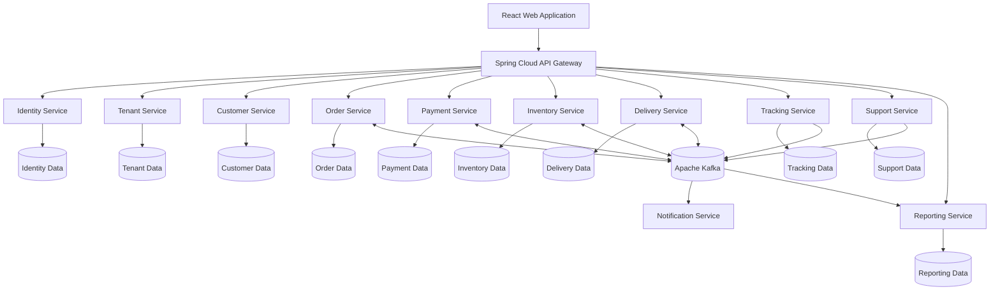
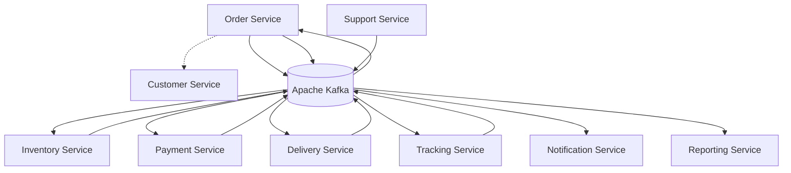
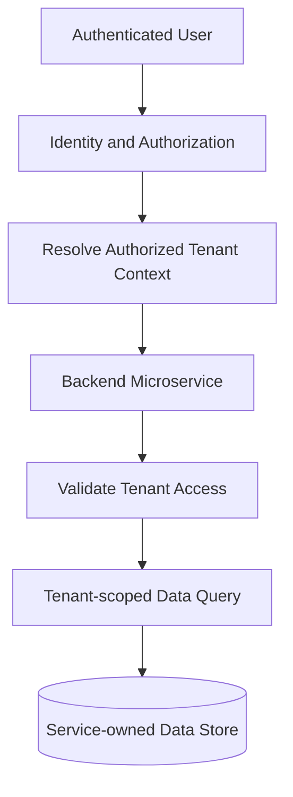

# FleetPulse – Microservices Design

**Document ID:** FP-DOC-004  
**Project:** FleetPulse – Smart Logistics & Real-Time Delivery Management System  
**Version:** 1.0  
**Status:** Draft – Pending Peer Review  
**Prepared:** November 2026  
**Related Document:** FP-DOC-002 – FleetPulse High-Level Design v1.0

---

# 1. Document Purpose

This document defines the proposed microservices architecture of FleetPulse.

It describes:

- Individual microservice responsibilities.
- Service boundaries and ownership.
- Logical data ownership.
- Inter-service communication.
- Service dependencies and event interactions.
- Security and multi-tenant considerations.
- Design principles for independent development and deployment.

This document provides the foundation for detailed API specifications, database design, event catalogues, and implementation planning.

# 2. Microservices Architecture Overview

FleetPulse follows a domain-oriented microservices architecture.

Each microservice represents a specific business capability and owns its business logic and persistence model.

The frontend communicates with backend services through Spring Cloud Gateway.

Services communicate using:

- **REST APIs:** For synchronous communication requiring an immediate response.
- **Apache Kafka:** For asynchronous event-driven communication.

Redis supports caching and real-time location access, while PostgreSQL provides durable relational storage.

## 2.1 Proposed Microservices

FleetPulse consists of the following eleven domain services:

| No. | Microservice | Primary responsibility |
|---|---|---|
| 1 | Identity Service | User authentication and authorization |
| 2 | Tenant Service | Tenant registration and management |
| 3 | Customer Service | Customer profile management |
| 4 | Order Service | Order creation and lifecycle |
| 5 | Payment Service | Payment simulation and transaction records |
| 6 | Inventory Service | Warehouse stock and reservations |
| 7 | Delivery Service | Driver assignment and delivery lifecycle |
| 8 | Tracking Service | GPS ingestion and real-time tracking |
| 9 | Notification Service | Email and in-app notifications |
| 10 | Support Service | Customer support tickets |
| 11 | Reporting Service | Operational reports and analytics |

## 2.2 Logical Architecture Diagram

**Note:** This is a logical architecture diagram. Notification Service primarily consumes relevant Kafka events rather than being directly exposed as a normal client-facing service. The data stores represent logical ownership, not a finalized physical database deployment.

# 3. Individual Microservice Design

## 3.1 Identity Service

**Responsibility:** User identity and access management.

### Core functionalities

- User registration and account management.
- User authentication.
- Credential management.
- Role and permission management.
- JWT-based authentication support.
- User identity administration.
- Authorization-related identity information.

### Data ownership

| Data | Description |
|---|---|
| Users | User account information |
| Credentials | Authentication credentials |
| Roles | Assigned user roles |
| Permissions | Access permissions |

### Security considerations

- Passwords must never be stored in plain text.
- Passwords must use secure hashing.
- JWT validation must be performed by authorized backend components.
- Access must follow role-based authorization.
- Tenant membership and tenant-specific role assignments must be represented in the authorization model.

**Proposed technology:** Java 21, Spring Boot, Spring Security, JWT.

## 3.2 Tenant Service

**Responsibility:** Multi-tenant registration and management.

### Core functionalities

- Tenant registration and onboarding.
- Tenant profile management.
- Tenant activation and suspension.
- Tenant configuration.
- Tenant-level settings.
- Tenant membership administration.
- Tenant operational configuration.

### Data ownership

| Data | Description |
|---|---|
| Tenants | Registered logistics companies |
| Memberships | User-to-tenant membership |
| Tenant Settings | Tenant-specific configurations |
| Tenant Status | Active or suspended status |

### Design considerations

- Every tenant must have a unique identifier.
- Tenant-specific data must be isolated.
- Tenant context must come from trusted authentication and authorization.
- Platform administrators and tenant administrators must have different authorization scopes.

## 3.3 Customer Service

**Responsibility:** Customer profile and information management.

### Core functionalities

- Customer profile creation and updates.
- Customer contact information.
- Customer address management.
- Customer preferences.
- Customer account history.

### Data ownership

| Data | Description |
|---|---|
| Customer Profiles | Customer information |
| Addresses | Delivery and contact addresses |
| Preferences | Customer preferences |
| Account History | Customer-related history |

### Design considerations

- Customer records must be tenant-aware.
- Customer information must be protected.
- Other services must obtain customer information through authorized APIs or events.
- Sensitive personal information must not be unnecessarily exposed in logs.

## 3.4 Order Service

**Responsibility:** Order creation and lifecycle management.

### Core functionalities

- Order creation.
- Order validation.
- Order item management.
- Order status transitions.
- Order cancellation.
- Order history.
- Coordination of order-related workflows.

### Data ownership

| Data | Description |
|---|---|
| Orders | Order master records |
| Order Items | Products and quantities |
| Order Status | Current order state |
| Status History | Order lifecycle history |

### Design considerations

- Order Service owns the order lifecycle.
- Valid order state transitions must be enforced.
- Inventory and payment results must be handled through defined APIs or events.
- Duplicate event processing must not create duplicate business operations.
- Distributed workflow failure and compensation must be considered.

## 3.5 Payment Service

**Responsibility:** Simulated payment processing for version 1.

### Core functionalities

- Payment initiation.
- Simulated payment processing.
- Payment status management.
- Payment transaction records.
- Refund simulation.
- Payment event publication.

### Data ownership

| Data | Description |
|---|---|
| Payment Transactions | Payment records |
| Payment Status | Payment processing state |
| Refund Records | Simulated refund information |

### Design considerations

- Version 1 will not process real financial transactions.
- Payment operations must be associated with valid orders and tenants.
- Payment status changes must be recorded.
- Duplicate payment requests must be handled safely.
- Payment-related events must be published reliably.

## 3.6 Inventory Service

**Responsibility:** Warehouse inventory and stock management.

### Core functionalities

- Warehouse inventory management.
- Stock availability checks.
- Stock reservation.
- Stock release.
- Inventory adjustments.
- Inventory movement history.
- Low-stock event publication.

### Data ownership

| Data | Description |
|---|---|
| Warehouses | Warehouse information |
| Stock | Available inventory |
| Reservations | Reserved stock records |
| Inventory Movements | Stock movement history |

### Design considerations

- Stock availability must be validated before reservation.
- Concurrent reservation requests must not cause incorrect stock quantities.
- Reservation and release operations must be idempotent where appropriate.
- Inventory updates must be tenant-aware.

## 3.7 Delivery Service

**Responsibility:** Driver assignment and delivery lifecycle management.

### Core functionalities

- Driver availability management.
- Delivery assignment.
- Delivery status management.
- Pickup confirmation.
- Delivery confirmation.
- Proof-of-delivery metadata.
- Delivery exception handling.

### Data ownership

| Data | Description |
|---|---|
| Drivers | Driver information |
| Assignments | Driver-to-delivery assignments |
| Delivery Status | Delivery lifecycle state |
| Proof of Delivery | Delivery confirmation metadata |

### Design considerations

- A delivery must be associated with a valid order.
- Driver assignments must be validated.
- Delivery status transitions must follow defined business rules.
- Delivery exceptions must be recorded.
- Relevant delivery events must be published for other services.

## 3.8 Tracking Service

**Responsibility:** Real-time GPS location ingestion and tracking.

### Core functionalities

- GPS location ingestion.
- Location validation.
- Latest driver location management.
- Tracking history.
- Delivery tracking state.
- Real-time location updates.
- Tracking event publication.

### Data ownership

| Data | Description |
|---|---|
| GPS History | Historical location records |
| Tracking Metadata | Tracking-related information |
| Latest Location | Most recent driver location |

### Design considerations

- Redis may store the latest location for fast access.
- Durable tracking history must be persisted.
- Driver-to-delivery assignment must be validated.
- Location updates must be tenant-aware.
- Authorized users receive tracking updates through WebSocket.
- GPS history retention must be defined during detailed design.

## 3.9 Notification Service

**Responsibility:** Event-driven customer and operational notifications.

### Core functionalities

- Email notifications.
- In-app notifications.
- Notification templates.
- Notification preferences.
- Event-driven notification delivery.
- Notification delivery status.
- Retry and failure handling.

### Data ownership

| Data | Description |
|---|---|
| Templates | Notification templates |
| Notifications | Notification records |
| Preferences | Notification preferences |
| Delivery Status | Notification delivery results |

### Design considerations

- Notification Service primarily consumes Kafka events.
- Notification failures must not unnecessarily block core business workflows.
- Retry handling must be implemented.
- Duplicate events must not cause unwanted duplicate notifications.
- External notification providers will be selected during integration design.

## 3.10 Support Service

**Responsibility:** Customer and operational support management.

### Core functionalities

- Support ticket creation.
- Ticket assignment.
- Ticket status management.
- Ticket priority management.
- Customer support history.
- Internal support notes.

### Data ownership

| Data | Description |
|---|---|
| Tickets | Support ticket records |
| Comments | Ticket comments |
| Assignments | Support agent assignments |
| Status History | Ticket lifecycle history |

### Design considerations

- Support tickets must be associated with the correct tenant.
- Access must be role-based.
- Internal support notes must be protected.
- Ticket creation events may trigger notifications.

## 3.11 Reporting Service

**Responsibility:** Operational reporting and business analytics.

### Core functionalities

- Operational dashboards.
- Order summaries.
- Delivery summaries.
- Tenant-level reports.
- Aggregated business metrics.
- Exportable reports.

### Data ownership

| Data | Description |
|---|---|
| Read Models | Reporting-specific projections |
| Aggregated Metrics | Business and operational metrics |
| Report Data | Report generation information |

### Design considerations

- Reporting Service may consume Kafka events to maintain read models.
- It must not directly query other services' databases.
- Reports must respect tenant-level access.
- Reporting workloads should not negatively affect transactional services.

# 4. Service Communication

FleetPulse uses synchronous and asynchronous communication.

## 4.1 REST Communication

REST APIs are used when an immediate response is required.

Examples:

- Frontend to API Gateway.
- Gateway to backend services.
- Order Service requesting customer validation.
- Tenant administration requesting tenant configuration.

REST communication must support:

- Authentication and authorization.
- Request validation.
- Timeouts.
- Consistent error responses.
- Correlation IDs.
- API versioning.
- Appropriate retry policies.

Exact API dependencies will be finalized in the API specification during LLD.

## 4.2 Kafka Event Communication

Kafka supports asynchronous communication between domain services.

Proposed event examples:

| Event | Producer | Potential consumers |
|---|---|---|
| OrderCreated | Order | Inventory, Notification, Reporting |
| InventoryReserved | Inventory | Order |
| InventoryRejected | Inventory | Order |
| PaymentCompleted | Payment | Order, Notification, Reporting |
| PaymentFailed | Payment | Order, Notification |
| DeliveryAssigned | Delivery | Tracking, Notification |
| LocationUpdated | Tracking | Reporting or tracking consumers |
| DeliveryCompleted | Delivery | Order, Notification, Reporting |
| TicketCreated | Support | Notification |

Event names and schemas are illustrative. The final event catalogue will be maintained separately.

# 5. Service Dependency Overview

The following diagram represents logical business interactions, not a finalized REST dependency graph.

**Important:** The exact interaction model, event ownership, and order workflow orchestration must be finalized during LLD.

# 6. Data Ownership and Isolation

Each microservice owns its persistence model.

| Service | Logical data ownership |
|---|---|
| Identity | Users, credentials, roles, permissions |
| Tenant | Tenants, memberships, tenant settings |
| Customer | Customer profiles, addresses |
| Order | Orders, order items, status history |
| Payment | Payment transactions, payment status |
| Inventory | Warehouses, stock, reservations |
| Delivery | Drivers, assignments, delivery status |
| Tracking | GPS history and tracking metadata |
| Notification | Templates, notification records |
| Support | Tickets, comments, assignments |
| Reporting | Aggregated read models and projections |

### Data management rules

1. Services must not access another service's database directly.
2. Cross-service information must be obtained through APIs or events.
3. Flyway will manage database schema migrations.
4. API communication must use appropriate DTOs.
5. Each service must maintain explicit transaction boundaries.
6. Timestamps must be stored consistently in UTC.
7. Data retention and archival policies must be defined.
8. Important business operations must maintain appropriate audit history.

**Database deployment decision:** Separate databases versus separate schemas within a shared PostgreSQL cluster remains an open design decision. Logical service ownership does not yet determine the physical deployment model.

# 7. Multi-Tenant Design

FleetPulse will use shared infrastructure with logical tenant isolation.

### Tenant isolation rules

- Every tenant-owned business record must be associated with a tenant.
- Tenant context must be derived from trusted authentication and authorization.
- Backend services must validate tenant access.
- Tenant IDs supplied in request bodies or query parameters must not be trusted on their own.
- Cross-tenant access must be prevented unless explicitly authorized.
- Platform administrators and tenant administrators must have separate access scopes.

### Tenant-aware request flow

# 8. Security Responsibilities

Every microservice must enforce appropriate security controls.

- Validate authentication and authorization.
- Apply role-based access control.
- Validate tenant context.
- Protect sensitive information.
- Validate incoming request data.
- Avoid exposing internal implementation details in error responses.
- Maintain security-relevant audit logs.
- Never log passwords, access tokens, or payment secrets.

Security must be enforced in backend services, not only at the API Gateway.

# 9. Resilience and Failure Handling

Microservices must be designed to handle partial failures.

Proposed controls include:

- Connection and request timeouts.
- Bounded retries with backoff.
- Circuit breakers where appropriate.
- Idempotent event consumers.
- Dead-letter handling.
- Health checks.
- Graceful shutdown.
- Database connection pool limits.
- Kafka consumer lag monitoring.

Distributed transactions should be avoided.

Use local transactions and event-driven coordination. Evaluate the Saga pattern for multi-step workflows and define compensating actions where required.

A transactional outbox may be used where reliable database-to-event publication is required.

# 10. Independent Development and Deployment

Each service should maintain a clear business boundary and be designed for independent development.

Proposed implementation standards:

- Java 21.
- Spring Boot.
- Spring Data JPA and Hibernate.
- PostgreSQL.
- Flyway.
- Spring Security.
- REST APIs.
- Apache Kafka where asynchronous communication is needed.
- JUnit 5 and Mockito.
- Docker.

The exact project structure, dependency versions, API contracts, and deployment configuration will be finalized during implementation planning.

# 11. Testing Strategy

Each microservice must have its own testing strategy.

| Test type | Purpose |
|---|---|
| Unit Testing | Validate business logic |
| Integration Testing | Validate database and messaging integration |
| API Testing | Validate REST endpoints |
| Security Testing | Validate authentication and authorization |
| Tenant Isolation Testing | Prevent cross-tenant access |
| Event Testing | Validate event publishing and consumption |
| Contract Testing | Validate service communication contracts |
| End-to-End Testing | Validate complete business workflows |

Critical testing areas include order lifecycle, inventory reservations, simulated payments, tenant isolation, delivery assignment, and GPS authorization.

# 12. Open Design Decisions

The following decisions must be reviewed before detailed implementation:

1. Should Identity Service use a custom Spring Security implementation or an external identity provider?
2. Should PostgreSQL use separate databases or separate schemas for each service?
3. Which service should orchestrate the order fulfilment Saga?
4. What event schema and versioning strategy should be used?
5. What should the initial API versioning convention be?
6. Which external email provider should Notification Service use?
7. What GPS history retention period should Tracking Service support?
8. Which services require independent deployment in the first release?

These decisions should be reviewed and recorded as Architecture Decision Records where appropriate.

# 13. Related Documents

| Document | Purpose |
|---|---|
| FP-DOC-001 | Business Requirements Document and Software Requirements Specification |
| FP-DOC-002 | High-Level Design |
| FP-DOC-003 | Architecture Diagrams |
| FP-DOC-005 | Communication Design |
| FP-DOC-006 | Infrastructure Design |
| Future LLD | Database Design, API Specification, Event Catalogue, and Sequence Diagrams |

# 14. Review and Approval

| Role | Name | Status | Date |
|---|---|---|---|
| Project Owner | TBD | Pending | TBD |
| Technical Reviewer | TBD | Pending | TBD |
| Team Member | TBD | Pending | TBD |

---

**End of Document**

**Document:** FP-DOC-004 – FleetPulse Microservices Design  
**Version:** 1.0  
**Status:** Draft – Pending Peer Review
