# FleetPulse – Class Diagrams

**Document ID:** FP-LLD-002  
**Version:** 1.0  
**Status:** Draft – Pending Team Review  
**Prepared:** November 2026

## 1. Purpose

This document describes the logical class architecture of FleetPulse using UML-style class diagrams.

It establishes the relationships between the major business domains and their owning microservices.

The diagrams will be refined into detailed Java class designs during service-level LLD.

## 2. Overall FleetPulse Domain Architecture

The following diagram represents the major domain entities and their ownership by the eleven proposed microservices.

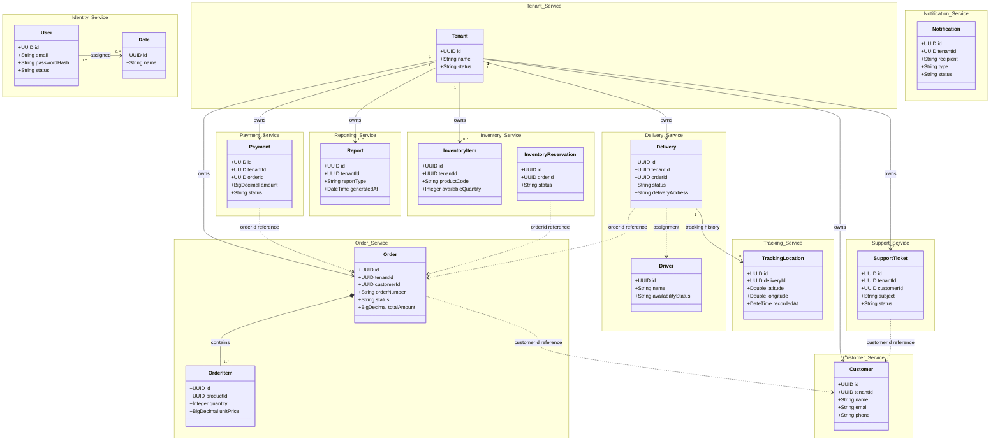

## 3. Diagram Interpretation

### 3.1 Identity Service

Responsible for user identity and role information.

Main conceptual classes:
- User
- Role

Authentication and authorization details will be defined in the Identity Service LLD.

### 3.2 Tenant Service

Responsible for tenant registration and management.

Main conceptual class:
- Tenant

Tenant ownership applies to tenant-specific business data.

### 3.3 Customer Service

Responsible for customer information.

Main conceptual class:
- Customer

Customer information is owned by Customer Service.

### 3.4 Order Service

Responsible for order creation and order lifecycle management.

Main conceptual classes:
- Order
- OrderItem

An order contains one or more order items.

### 3.5 Payment Service

Responsible for payment processing and payment status.

Main conceptual class:
- Payment

In version 1, payment processing is simulated. Real financial transactions are outside the current scope.

### 3.6 Inventory Service

Responsible for inventory availability and reservation.

Main conceptual classes:
- InventoryItem
- InventoryReservation

### 3.7 Delivery Service

Responsible for delivery management and driver assignment.

Main conceptual classes:
- Delivery
- Driver

### 3.8 Tracking Service

Responsible for GPS location ingestion and tracking history.

Main conceptual class:
- TrackingLocation

Latest location caching and durable tracking history are infrastructure and persistence concerns that will be detailed separately.

### 3.9 Notification Service

Responsible for processing notification requests and tracking notification status.

Main conceptual class:
- Notification

### 3.10 Support Service

Responsible for customer support requests and issue management.

Main conceptual class:
- SupportTicket

### 3.11 Reporting Service

Responsible for generating business and operational reports.

Main conceptual class:
- Report

## 4. Important Design Rules

1. Each microservice owns its domain entities and business logic.
2. A class shown in one service must not be interpreted as a shared Java entity across services.
3. Cross-service references such as `customerId` and `orderId` represent identifiers, not direct database relationships.
4. Services must communicate through approved REST APIs or Kafka events.
5. Tenant-owned data must be protected through tenant-aware authorization.
6. Exact fields, methods, relationships, and database constraints will be finalized in service-level LLD.

## 5. Next Design Activity

The next diagram will define the detailed Identity Service class architecture, including:

- User entity
- Role entity
- Authentication request and response DTOs
- Authentication service
- User service
- User repository
- JWT service
- Security configuration
- Authentication controller

The detailed design will be reviewed before implementation.

---

**End of Part 1 – Overall FleetPulse Domain Architecture**

---

# Part 2 – Identity Service Class Diagram

## 6. Identity Service – Detailed Class Design

### 6.1 Purpose

Identity Service is responsible for managing user identity and supporting authentication-related operations.

Its proposed responsibilities include:

- User identity management
- User registration, where applicable
- Authentication
- Role assignment and lookup
- JWT-based security integration
- User account status management

**Design consideration:** The final authentication ownership model (custom authentication versus external identity provider) is still pending team approval. The diagram represents a proposed custom authentication implementation.

### 6.2 Identity Service Class Diagram

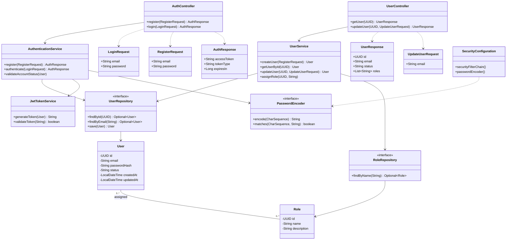

### 6.3 Component Responsibilities

| Component | Responsibility |
|---|---|
| AuthController | Handles registration and login API requests |
| UserController | Handles user profile and account management APIs |
| AuthenticationService | Coordinates authentication and account validation |
| UserService | Implements user management business logic |
| UserRepository | Handles user persistence |
| RoleRepository | Handles role persistence |
| JwtTokenService | Generates and validates tokens if custom token issuance is selected |
| PasswordEncoder | Secure password hashing and verification |
| SecurityConfiguration | Configures Spring Security |
| User | Represents the user identity entity |
| Role | Represents an application role |

### 6.4 Authentication Flow

1. Client submits login credentials.
2. AuthController receives the request.
3. AuthenticationService retrieves the user.
4. Account status and credentials are validated.
5. PasswordEncoder verifies the password.
6. JwtTokenService generates an access token, if custom authentication is selected.
7. AuthResponse is returned to the client.

### 6.5 Design Rules

- Passwords must never be stored in plain text.
- Password hashes must use an appropriate secure password encoder.
- Authentication endpoints must be protected against abuse.
- JWT validation must use the approved security configuration.
- User and role information must be validated before authorization.
- Sensitive information must never be exposed in API responses.
- Tenant membership and tenant ownership must remain consistent with Tenant Service responsibilities.

### 6.6 Open Design Decisions

1. Custom JWT issuance or external identity provider?
2. Will user registration be public or administrator-controlled?
3. What roles will be supported initially?
4. How will user-to-tenant membership be represented?
5. What token expiration and refresh-token strategy will be used?

**Implementation status:** Proposed design only. Not yet implemented or approved.

---

**End of Part 2 – Identity Service Class Design**

---
# Part 3 – Tenant Service Class Diagram

## 7. Tenant Service – Detailed Class Design

### 7.1 Purpose

Tenant Service manages tenant registration, tenant information, and tenant lifecycle within the FleetPulse multi-tenant platform.

### 7.2 Class Diagram

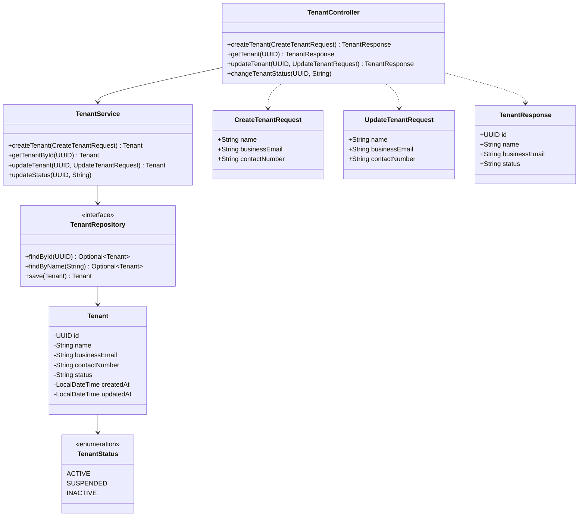

### 7.3 Component Responsibilities

| Component | Responsibility |
|---|---|
| TenantController | Exposes tenant management APIs |
| TenantService | Implements tenant business rules |
| TenantRepository | Handles tenant persistence |
| Tenant | Represents a tenant organization |
| CreateTenantRequest | Captures tenant creation details |
| UpdateTenantRequest | Captures tenant update details |
| TenantResponse | Returns tenant information |
| TenantStatus | Defines supported tenant lifecycle states |

### 7.4 Business Rules

1. Every tenant must have a unique identifier.
2. Tenant creation must validate required business information.
3. Tenant status changes must follow authorized operations.
4. Suspended or inactive tenants must not access protected business operations.
5. Tenant ownership must be enforced consistently across tenant-owned services.
6. Tenant identifiers received from clients must not independently establish authorization.

### 7.5 Service Boundaries

Tenant Service owns tenant master information.

Other services may store the tenant identifier as part of their own business records, but must not directly access Tenant Service's database.

Tenant validation and authorization should use approved service or token-based mechanisms.

### 7.6 Open Design Decisions

- Who is authorized to create a tenant?
- Is tenant onboarding performed through an administrator?
- Will tenant configuration be stored in Tenant Service?
- How will tenant status changes be communicated to other services?
- Will tenant plans or subscription management be included in v1?

**Implementation status:** Proposed design only. Pending team review.

---

**End of Part 3 – Tenant Service Class Design**

## 4. Customer Service – Class Diagram

### 4.1 Purpose

The Customer Service manages customer profiles and their contact information within a tenant.

It owns customer-related business logic and customer data.

### 4.2 Class Diagram

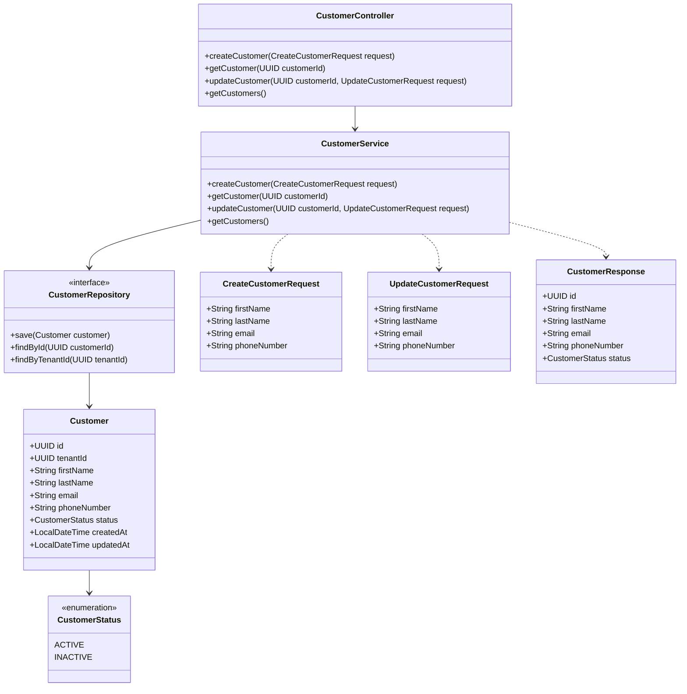

### 4.3 Responsibilities

| Component | Responsibility |
|---|---|
| CustomerController | Exposes customer REST APIs |
| CustomerService | Handles customer business logic |
| CustomerRepository | Performs customer database operations |
| Customer | Represents the customer entity |
| Request DTOs | Carry incoming API data |
| CustomerResponse | Returns customer information |
| CustomerStatus | Defines customer account status |

### 4.4 Business Rules

1. Every customer must belong to a valid tenant.
2. Customer records must be isolated by tenant.
3. A customer cannot access another tenant's customer information.
4. Email uniqueness should be enforced within the agreed tenant scope.
5. Inactive customers should not be eligible for new orders.
6. Tenant ownership must come from trusted authentication and authorization context, not blindly from client input.

### 4.5 Service Boundary

- Customer Service owns customer profile data.
- Order Service stores the customer ID as a reference when creating an order.
- Order Service must not directly access the Customer Service database.
- Customer information must be accessed through an approved API or event-driven integration.

### 4.6 Design Notes

- `tenantId` is stored as an identifier, not as a cross-service JPA relationship.
- UUID is proposed for entity identifiers.
- Audit timestamps are included.
- Final validation rules and API details will be finalized in the API Specification and Database Design documents.

**Status:** Proposed design – Pending team review.
## 5. Order Service – Class Diagram

### 5.1 Purpose

The Order Service manages the order lifecycle, including order creation, order items, order status transitions, and coordination with other services.

It is the owner of order-related business logic and order data.

### 5.2 Class Diagram

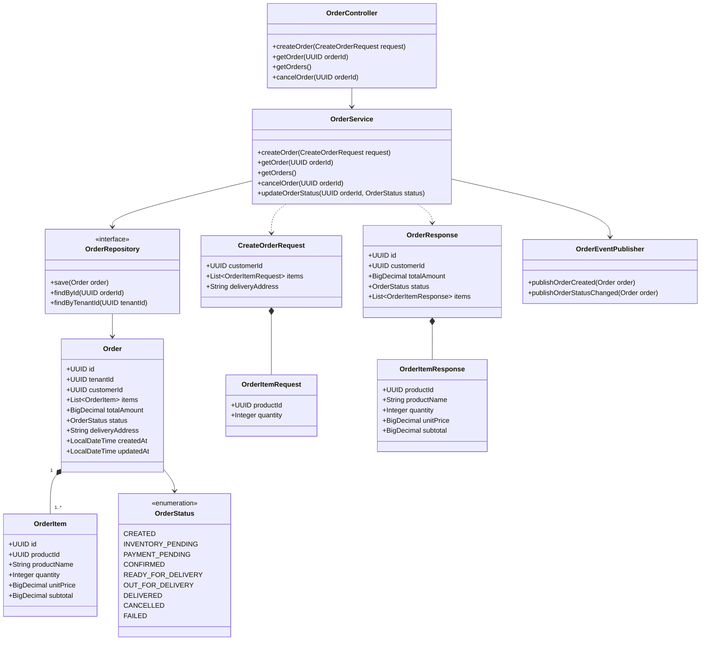

### 5.3 Responsibilities

| Component | Responsibility |
|---|---|
| OrderController | Exposes order REST APIs |
| OrderService | Manages order creation and lifecycle |
| OrderRepository | Performs order database operations |
| Order | Represents the main order entity |
| OrderItem | Represents individual products in an order |
| OrderEventPublisher | Publishes order-related Kafka events |
| OrderStatus | Defines order lifecycle states |
| Request/Response DTOs | Handle API communication |

### 5.4 Business Rules

1. Every order must belong to a valid tenant.
2. Every order must reference a valid customer.
3. An order must contain at least one order item.
4. Quantity must be greater than zero.
5. Total amount must be calculated and validated on the server.
6. Only valid order status transitions are permitted.
7. An order belonging to one tenant must not be accessible to another tenant.
8. Order creation should publish an `OrderCreated` event.
9. Order cancellation must follow the agreed business workflow, including inventory reservation release where applicable.

### 5.5 Order Lifecycle

Proposed high-level order lifecycle:

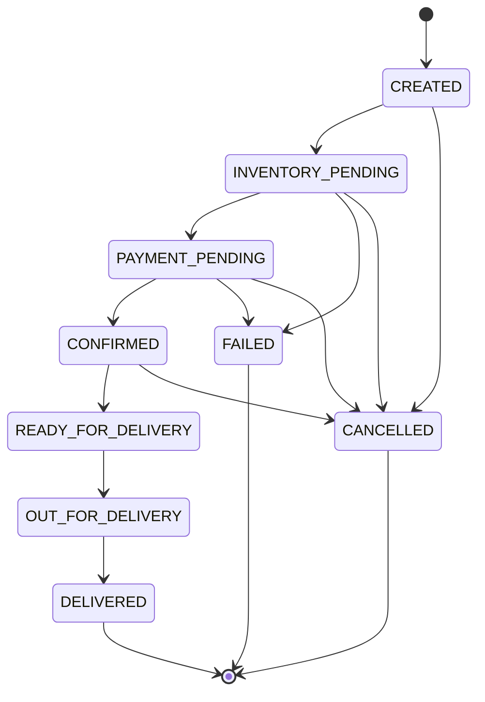

### 5.6 Service Boundary

- Order Service owns order and order-item data.
- Customer information is referenced through `customerId`.
- Product and inventory information is obtained through approved service APIs or events.
- Payment processing belongs to Payment Service.
- Delivery assignment belongs to Delivery Service.
- Order Service must not directly access another service's database.
- Kafka events are used for asynchronous workflow coordination.

### 5.7 Design Notes

- `tenantId` and `customerId` are identifiers, not cross-service JPA relationships.
- `OrderItem` belongs to the Order aggregate.
- Prices and product names may be stored as order-time snapshots so historical orders remain consistent if product details later change.
- `OrderEventPublisher` represents the publishing responsibility; reliable event publishing and the transactional outbox pattern require a detailed design decision.
- Payment processing in the initial version is simulated only.
- The exact order orchestration approach, including Saga coordination, remains subject to team review.

**Status:** Proposed design – Pending team review.
## 6. Payment Service – Class Diagram

### 6.1 Purpose

The Payment Service manages payment records and payment processing workflows associated with customer orders.

For FleetPulse v1, payment processing will be simulated. No real financial transactions will be performed.

### 6.2 Class Diagram

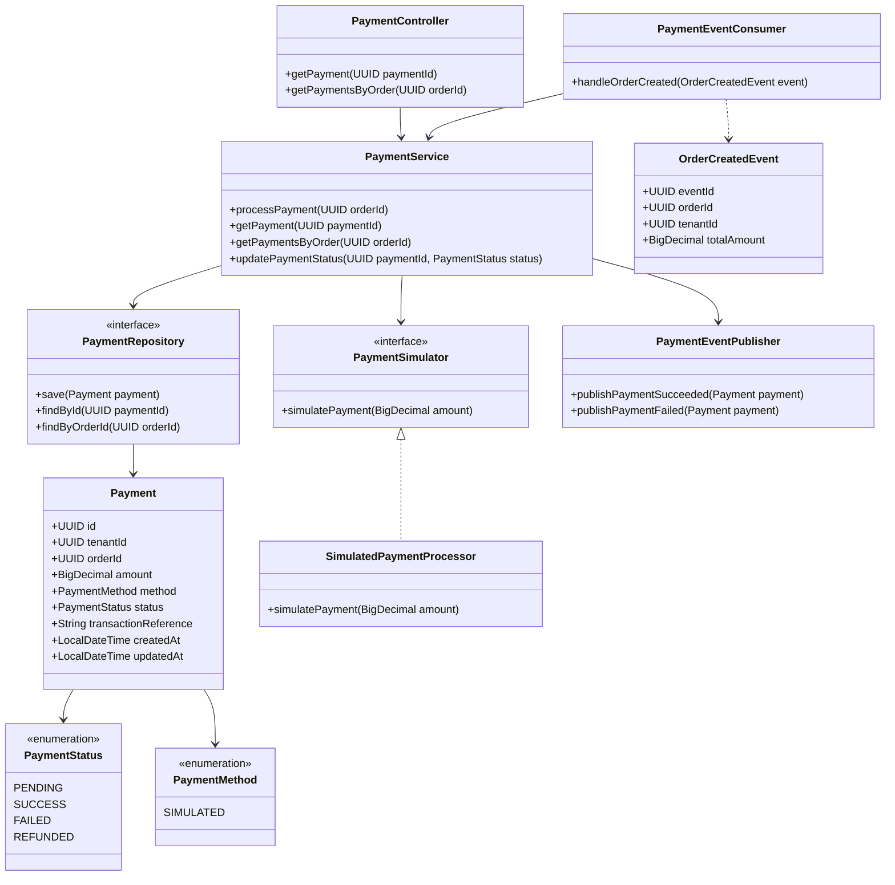

### 6.3 Responsibilities

| Component | Responsibility |
|---|---|
| PaymentController | Exposes payment-related read APIs |
| PaymentEventConsumer | Consumes relevant Kafka events |
| PaymentService | Manages payment processing logic |
| PaymentRepository | Handles payment database operations |
| Payment | Represents a payment record |
| PaymentSimulator | Defines simulated payment processing |
| SimulatedPaymentProcessor | Implements simulated payment outcomes |
| PaymentEventPublisher | Publishes payment result events |
| PaymentStatus | Defines payment lifecycle states |

### 6.4 Business Rules

1. Every payment must belong to a valid tenant.
2. Every payment must reference an existing order through `orderId`.
3. Payment amount must be greater than zero.
4. Payment processing must be idempotent to prevent duplicate processing.
5. A payment must not be processed again if a successful result already exists for the same order.
6. Payment status must follow valid state transitions.
7. Payment Service must publish a success or failure event after processing.
8. Payment processing in v1 must remain simulated.

### 6.5 Payment Processing Flow

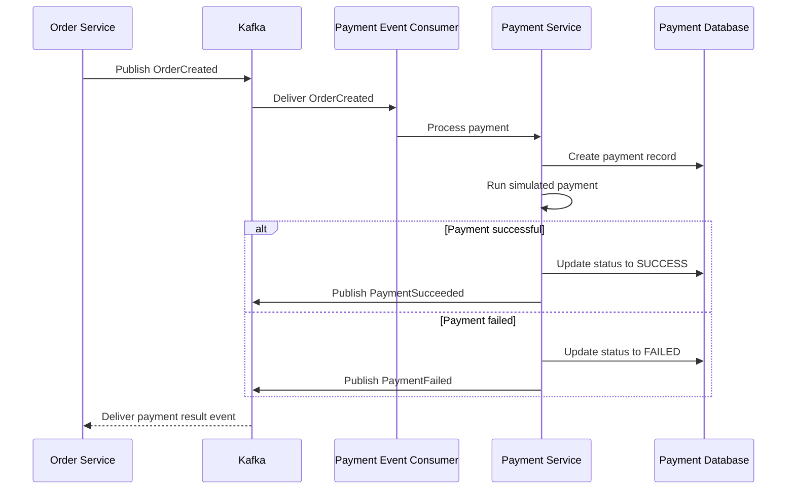

### 6.6 Service Boundary

- Payment Service owns payment records and processing logic.
- Order Service owns order information and order status.
- Payment Service references orders using `orderId`, not a cross-service JPA relationship.
- Payment Service communicates payment outcomes through Kafka events.
- Payment Service must not directly update the Order Service database.
- Other services must not directly access the Payment Service database.

### 6.7 Design Notes

- `tenantId` and `orderId` are identifiers.
- UUID is proposed for payment identifiers.
- `transactionReference` represents a simulated transaction reference in v1.
- The `PaymentSimulator` abstraction allows us to replace the simulated processor with a real payment integration in a future version, subject to separate security and compliance design.
- Kafka event delivery, retries, duplicate handling and dead-letter processing will be detailed in the Event Catalog.
- Payment failure and order cancellation coordination will be finalized in the workflow design.

**Status:** Proposed design – Pending team review.
## 7. Inventory Service – Class Diagram

### 7.1 Purpose

The Inventory Service manages product stock availability and inventory reservations for customer orders.

It is responsible for maintaining inventory quantities and ensuring that stock is reserved correctly before an order proceeds to payment.

### 7.2 Class Diagram

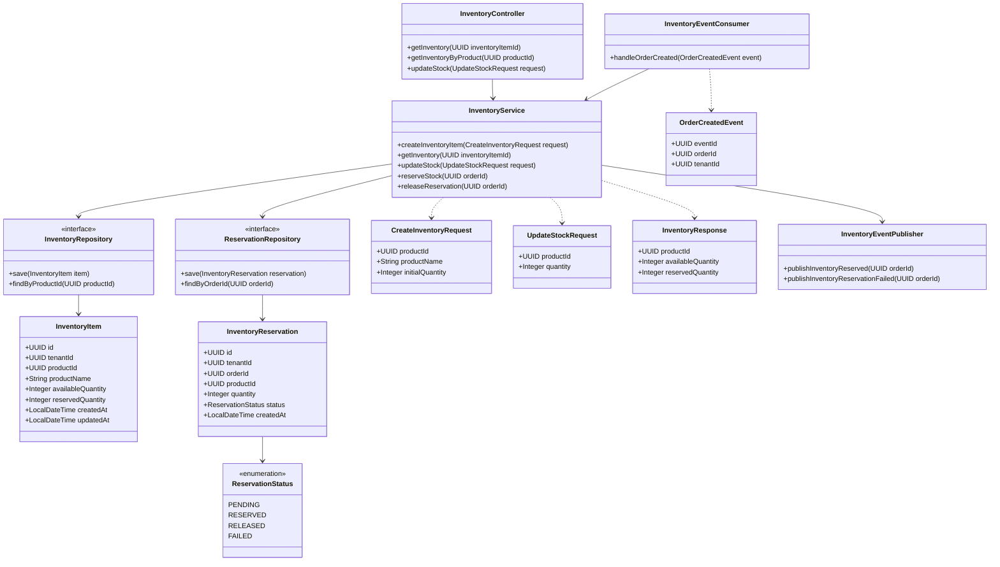

### 7.3 Responsibilities

| Component | Responsibility |
|---|---|
| InventoryController | Exposes inventory REST APIs |
| InventoryEventConsumer | Consumes order-related Kafka events |
| InventoryService | Manages stock and reservation logic |
| InventoryRepository | Handles inventory item persistence |
| ReservationRepository | Handles reservation persistence |
| InventoryItem | Represents available and reserved stock |
| InventoryReservation | Represents stock reserved for an order |
| InventoryEventPublisher | Publishes reservation outcomes |
| ReservationStatus | Defines reservation lifecycle |

### 7.4 Business Rules

1. Every inventory item must belong to a valid tenant.
2. Available stock cannot be negative.
3. Reservation quantity must be greater than zero.
4. Stock must be checked before reservation.
5. Inventory reservation must be atomic to prevent overselling.
6. A reservation must be linked to an order using `orderId`.
7. Repeated processing of the same order event must not create duplicate reservations.
8. Failed reservations must publish an appropriate failure event.
9. Successful reservations must publish an appropriate success event.
10. Cancellation workflows must release reserved stock when applicable.

### 7.5 Inventory Reservation Flow

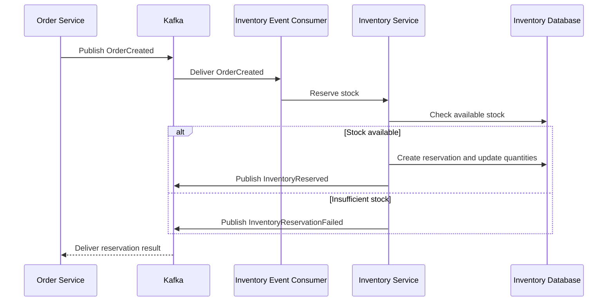

### 7.6 Service Boundary

- Inventory Service owns inventory quantities and reservation records.
- Order Service owns order information.
- Product identifiers are stored as references; Inventory Service does not access another service's database.
- Inventory reservation results are communicated through Kafka events.
- Inventory Service must not directly update order status.
- Only authorized operations may update stock quantities.

### 7.7 Design Notes

- `tenantId`, `productId` and `orderId` are identifiers.
- Inventory reservation and stock updates must be transactionally consistent within Inventory Service.
- Concurrency control will be finalized during implementation using an appropriate database locking or atomic update strategy.
- Reservation expiry and automatic release policies are open design decisions.
- The inventory data model will be detailed in the Database Design document.
- Event names and payloads will be finalized in the Event Catalog.

**Status:** Proposed design – Pending team review.

## 8. Delivery Service – Class Diagram

### 8.1 Purpose

The Delivery Service manages delivery assignment, driver information, and delivery lifecycle tracking.

It receives orders that are ready for delivery, assigns available drivers, and manages delivery status until completion.

### 8.2 Class Diagram

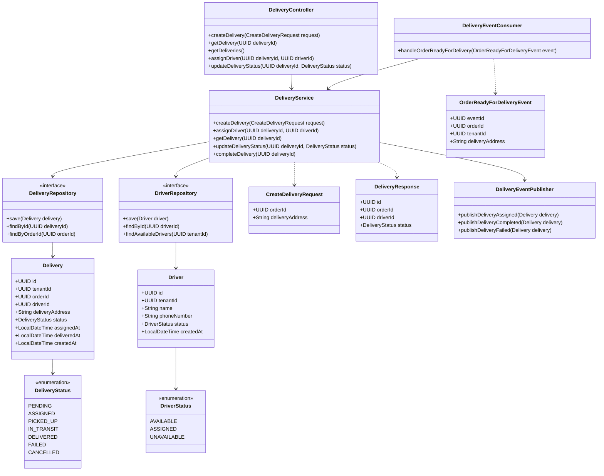

### 8.3 Responsibilities

| Component | Responsibility |
|---|---|
| DeliveryController | Exposes delivery REST APIs |
| DeliveryEventConsumer | Consumes order readiness events |
| DeliveryService | Manages delivery assignment and lifecycle |
| DeliveryRepository | Handles delivery persistence |
| DriverRepository | Handles driver persistence and availability |
| Delivery | Represents an order delivery |
| Driver | Represents a delivery driver |
| DeliveryEventPublisher | Publishes delivery lifecycle events |
| DeliveryStatus | Defines delivery lifecycle states |
| DriverStatus | Defines driver availability states |

### 8.4 Business Rules

1. Every delivery must belong to a valid tenant.
2. A delivery must reference a valid order.
3. A delivery must not be created twice for the same order.
4. Only available drivers can be assigned.
5. A driver should not receive multiple active deliveries unless the business rules explicitly permit it.
6. Driver and delivery tenant ownership must match.
7. Delivery status must follow valid transitions.
8. A completed delivery must record its completion timestamp.
9. Failed or cancelled deliveries must follow the agreed exception workflow.
10. Delivery assignment and status changes must be authorized.

### 8.5 Delivery Assignment Flow

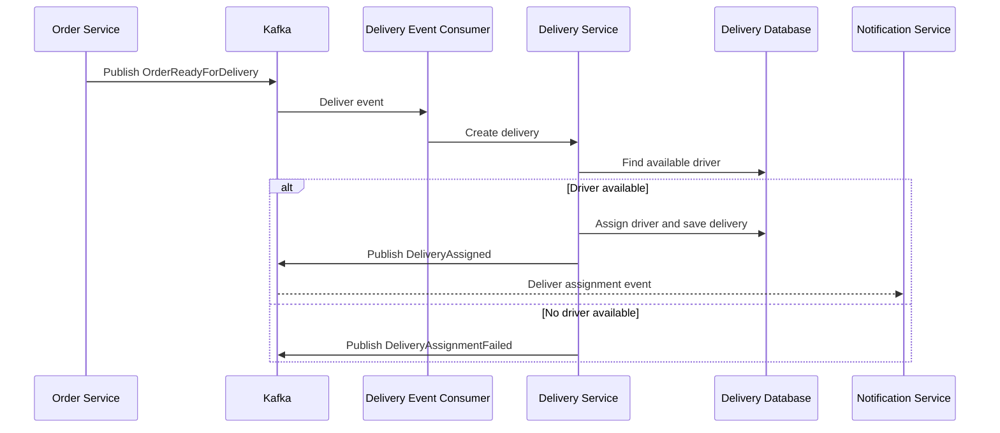

### 8.6 Service Boundary

- Delivery Service owns driver and delivery records.
- Order Service owns order information.
- Delivery Service receives order readiness through Kafka events.
- Tracking Service manages GPS location updates separately.
- Delivery Service communicates assignment and completion outcomes through Kafka events.
- Delivery Service must not directly update Order Service database records.
- Notification Service consumes delivery events to notify relevant users.

### 8.7 Design Notes

- `tenantId`, `orderId` and `driverId` are identifiers.
- Driver assignment strategy will initially be simple and can be improved later.
- GPS coordinates and location history belong to Tracking Service, not Delivery Service.
- Driver availability and delivery assignment must be updated consistently.
- Driver onboarding and authentication ownership will be clarified during detailed service design.
- Event names and payloads will be finalized in the Event Catalog.

**Status:** Proposed design – Pending team review.
## 9. Tracking Service – Class Diagram

### 9.1 Purpose

The Tracking Service manages real-time driver location updates and location history.

It receives GPS coordinates from drivers, maintains the latest location in Redis, stores durable location history in PostgreSQL, and broadcasts authorized real-time updates.

### 9.2 Class Diagram

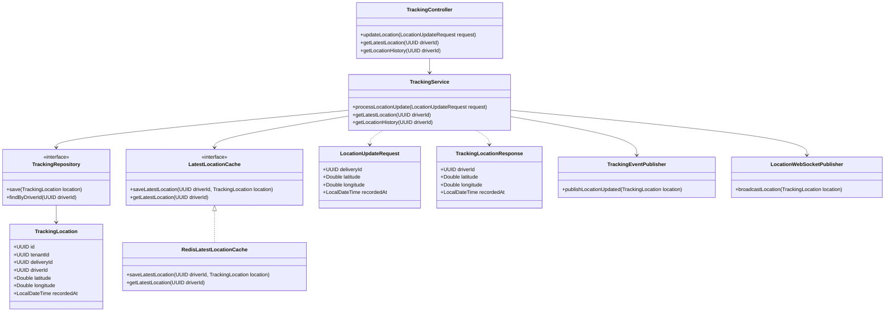

### 9.3 Responsibilities

| Component | Responsibility |
|---|---|
| TrackingController | Exposes tracking REST APIs |
| TrackingService | Processes GPS updates and retrieves location information |
| TrackingRepository | Persists durable location history |
| LatestLocationCache | Defines latest-location cache operations |
| RedisLatestLocationCache | Implements latest-location storage using Redis |
| TrackingLocation | Represents a GPS location record |
| TrackingEventPublisher | Publishes location-related Kafka events |
| LocationWebSocketPublisher | Broadcasts authorized real-time location updates |

### 9.4 Business Rules

1. Every location update must belong to a valid tenant and authorized driver.
2. Latitude must be between -90 and 90.
3. Longitude must be between -180 and 180.
4. Location updates must reference a valid delivery.
5. Older GPS updates must not overwrite newer latest-location data.
6. Latest driver location must be stored in Redis.
7. Durable location history must be stored in PostgreSQL.
8. Location updates must be published to authorized subscribers only.
9. Customers must only access tracking information for deliveries they are authorized to view.
10. GPS updates must not expose one tenant's delivery information to another tenant.

### 9.5 GPS Location Processing Flow

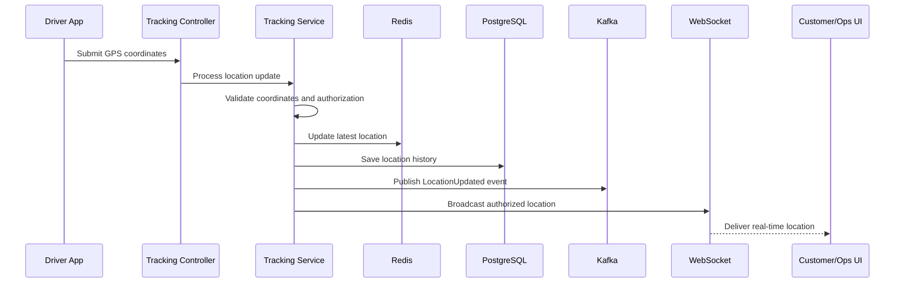

### 9.6 Service Boundary

- Tracking Service owns GPS location processing and location history.
- Delivery Service owns delivery assignment and delivery lifecycle.
- Driver and delivery identifiers are stored as references.
- Redis stores the latest location for fast retrieval.
- PostgreSQL stores durable location history.
- Kafka distributes location events to interested services.
- WebSocket provides real-time updates to authorized clients.
- Tracking Service must not directly access Delivery Service database records.

### 9.7 Design Notes

- `tenantId`, `deliveryId` and `driverId` are identifiers.
- Redis is used for latest-location lookup, not as the only permanent location store.
- PostgreSQL is responsible for durable location history.
- Location history retention and GPS update frequency are open design decisions.
- WebSocket authorization must validate tenant and delivery access.
- Location event structure and topic names will be finalized in the Event Catalog.
- A GPS visibility target of under five seconds under normal test conditions is proposed, not a guaranteed production SLA.

**Status:** Proposed design – Pending team review.
## 10. Notification Service – Class Diagram

### 10.1 Purpose

The Notification Service manages notifications generated by business events across FleetPulse.

It consumes Kafka events and delivers notifications through configured communication channels.

For v1, the notification provider and delivery channel integrations are subject to team review.

### 10.2 Class Diagram

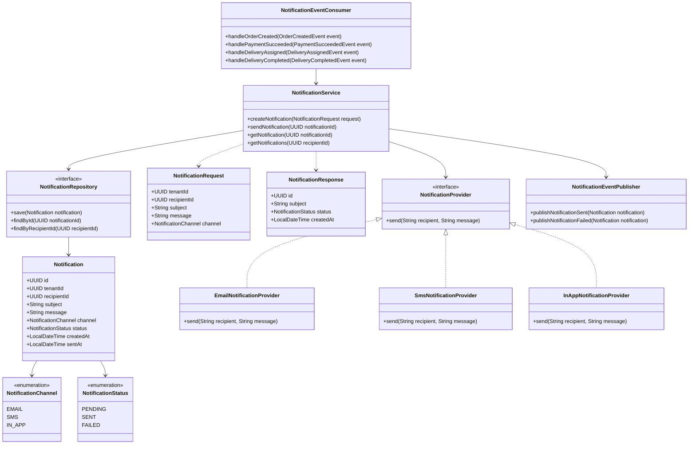

### 10.3 Responsibilities

| Component | Responsibility |
|---|---|
| NotificationEventConsumer | Consumes business events from Kafka |
| NotificationService | Creates and manages notifications |
| NotificationRepository | Handles notification persistence |
| Notification | Represents a notification record |
| NotificationProvider | Defines the notification delivery contract |
| EmailNotificationProvider | Handles email delivery |
| SmsNotificationProvider | Handles SMS delivery |
| InAppNotificationProvider | Handles in-app notification delivery |
| NotificationEventPublisher | Publishes notification delivery outcomes |

### 10.4 Business Rules

1. Every notification must belong to a valid tenant.
2. Every notification must have a valid recipient.
3. Notifications must be generated only from supported business events or authorized requests.
4. Notification processing must be idempotent to prevent duplicate notifications.
5. Notification status must be updated after delivery attempts.
6. Failed notifications may be retried according to the configured retry policy.
7. Sensitive information must not be exposed in notification messages.
8. Notification delivery failures must not directly modify the source business service's database.
9. Notification access must be restricted to authorized recipients.

### 10.5 Notification Processing Flow

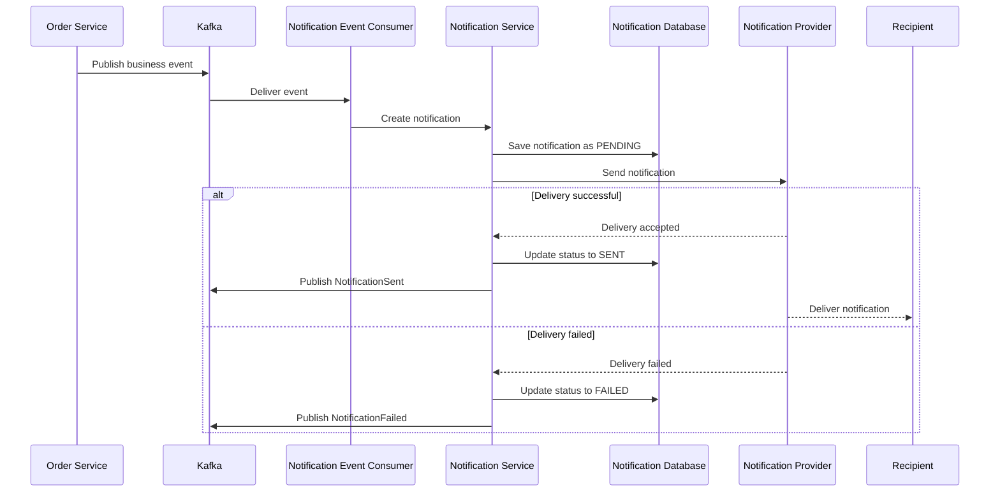

### 10.6 Service Boundary

- Notification Service owns notification records and delivery orchestration.
- Business services publish events; they do not directly send notifications.
- Notification Service consumes approved Kafka events.
- Notification Service must not directly access other services' databases.
- External notification providers are accessed through provider interfaces and adapters.
- Notification delivery outcomes are communicated through events when required.

### 10.7 Design Notes

- `tenantId` and `recipientId` are identifiers.
- Email, SMS and in-app channels are proposed options.
- The actual email/SMS provider has not yet been selected.
- Provider-specific credentials must be stored securely and never hardcoded.
- Retry handling, delivery receipts and dead-letter processing will be detailed in the Event Catalog and infrastructure design.
- Notification templates and localization are future design considerations.
- Kafka event names and payloads will be finalized in the Event Catalog.

**Status:** Proposed design – Pending team review.
## 11. Support Service – Class Diagram

### 11.1 Purpose

The Support Service manages customer support requests and issues raised by customers or operations users.

It provides functionality to create support tickets, assign tickets, update ticket status, and maintain communication history.

### 11.2 Class Diagram

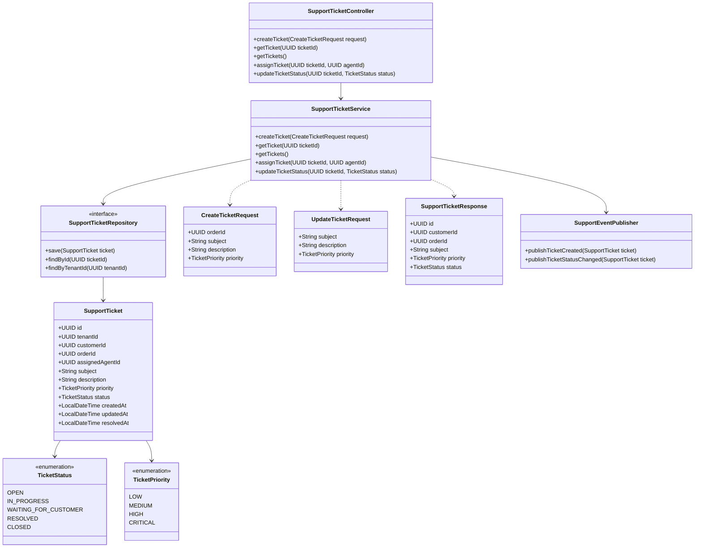

### 11.3 Responsibilities

| Component | Responsibility |
|---|---|
| SupportTicketController | Exposes support ticket REST APIs |
| SupportTicketService | Manages ticket creation and lifecycle |
| SupportTicketRepository | Handles ticket persistence |
| SupportTicket | Represents a customer support ticket |
| SupportEventPublisher | Publishes ticket-related events |
| TicketStatus | Defines ticket lifecycle states |
| TicketPriority | Defines ticket urgency levels |
| Request/Response DTOs | Handle API communication |

### 11.4 Business Rules

1. Every support ticket must belong to a valid tenant.
2. A ticket must be associated with an authorized customer.
3. An order reference is optional but must be valid when provided.
4. Every ticket must have a subject and description.
5. Ticket priority must be assigned from the supported priority levels.
6. Only authorized support agents can assign tickets.
7. Ticket status must follow valid state transitions.
8. Resolved tickets must record a resolution timestamp.
9. Customers must only access their own support tickets.
10. Support agents must only access tickets within their authorized tenant scope.

### 11.5 Support Ticket Lifecycle

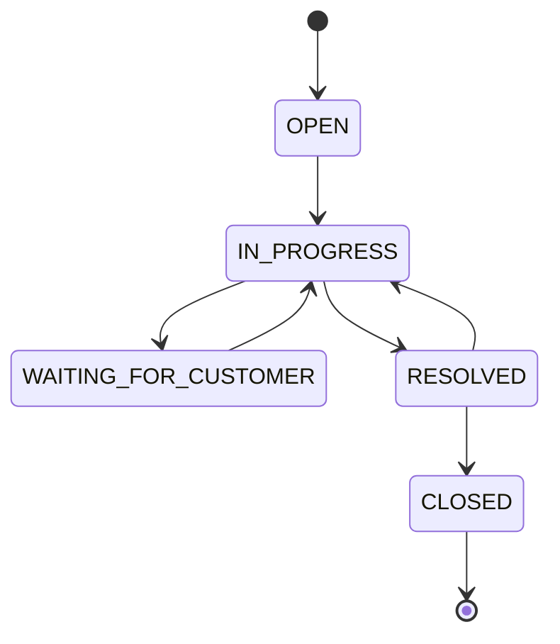

### 11.6 Service Boundary

- Support Service owns support tickets and their lifecycle.
- Customer and order identifiers are stored as references.
- Customer and order information must be obtained through approved APIs or events when required.
- Support Service must not directly access Customer Service or Order Service databases.
- Support ticket events are published through Kafka where integration is required.
- Support access must follow tenant-level authorization.

### 11.7 Design Notes

- `tenantId`, `customerId`, `orderId` and `assignedAgentId` are identifiers.
- UUID is proposed for ticket identifiers.
- Ticket conversation history and attachments may be introduced as separate domain components in a future iteration.
- Support agent identity and role ownership will be clarified with the Identity Service design.
- SLA rules, escalation policies and automatic ticket assignment are future design considerations.
- Event names and payloads will be finalized in the Event Catalog.

**Status:** Proposed design – Pending team review.
## 12. Reporting Service – Class Diagram

### 12.1 Purpose

The Reporting Service provides business reports and operational insights across the FleetPulse platform.

It generates reports using authorized data collected from approved service APIs, Kafka events, and reporting read models.

It does not directly access other microservices' databases.

### 12.2 Class Diagram

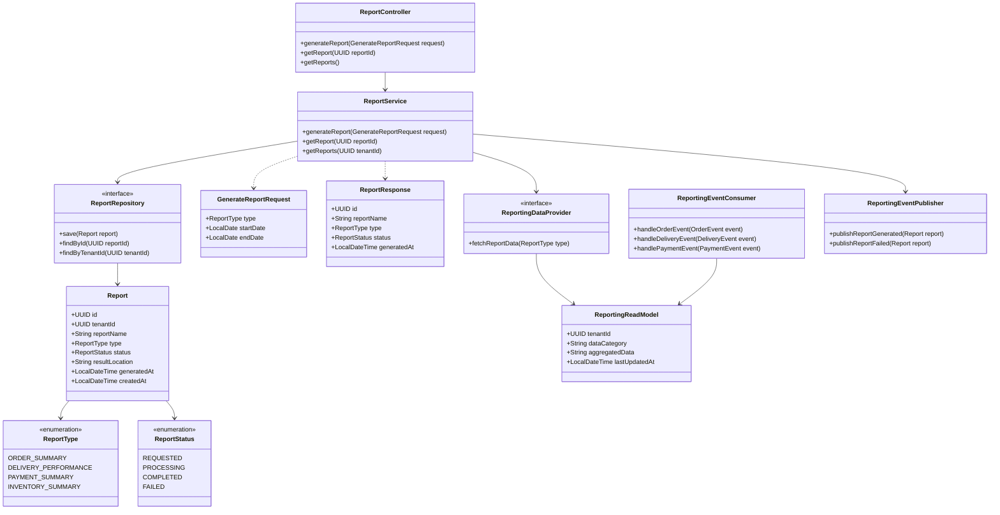

### 12.3 Responsibilities

| Component | Responsibility |
|---|---|
| ReportController | Exposes reporting REST APIs |
| ReportService | Manages report generation and retrieval |
| ReportRepository | Handles report metadata persistence |
| Report | Represents a generated report |
| ReportingDataProvider | Provides data required for report generation |
| ReportingReadModel | Stores reporting-oriented aggregated data |
| ReportingEventConsumer | Consumes business events for reporting |
| ReportingEventPublisher | Publishes report generation outcomes |
| ReportType | Defines supported report categories |
| ReportStatus | Defines report generation states |

### 12.4 Business Rules

1. Every report must belong to a valid tenant.
2. Users can only generate reports within their authorized tenant scope.
3. Report date ranges must be validated.
4. Report generation must support the configured report types.
5. Large reports should be generated asynchronously.
6. Report status must be updated throughout the generation lifecycle.
7. Failed report generation must be recorded.
8. Reporting data must be obtained through approved integration mechanisms.
9. Reporting Service must not directly query another microservice's database.
10. Sensitive customer and business information must be protected in generated reports.

### 12.5 Report Generation Flow

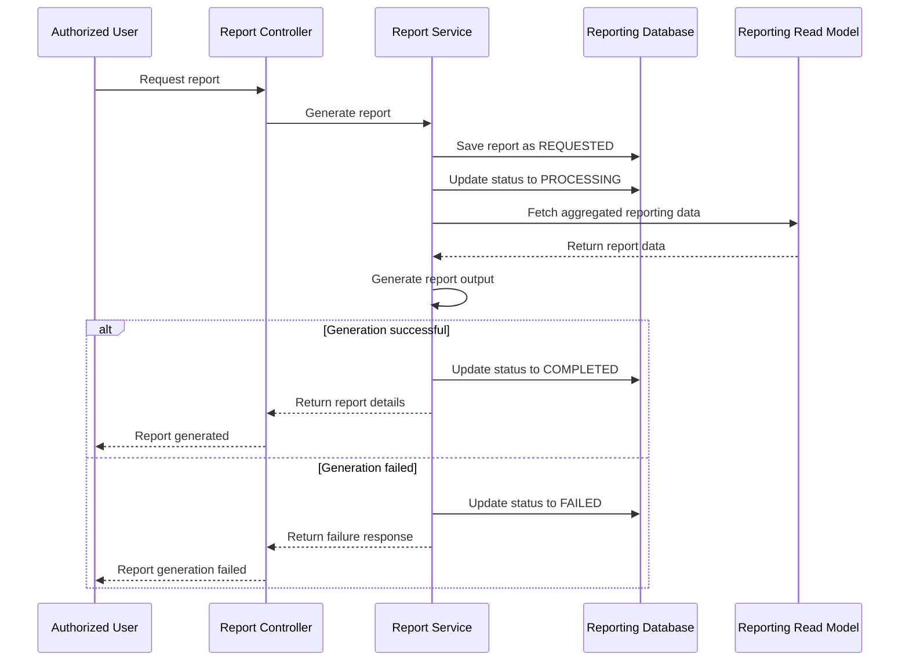

### 12.6 Service Boundary

- Reporting Service owns report metadata and reporting read models.
- Business services remain the owners of their operational data.
- Reporting data is populated through approved Kafka events or service APIs.
- Reporting Service must not directly access operational databases owned by other microservices.
- Reporting read models may contain denormalized data optimized for reporting queries.
- Access to reports must follow tenant-level authorization.

### 12.7 Design Notes

- `tenantId` is used to enforce reporting data isolation.
- Reporting read models are separate from operational service databases.
- Kafka events are proposed for maintaining reporting data.
- `resultLocation` may reference generated report files stored in object storage.
- Report formats, storage provider, scheduling and retention policies remain open decisions.
- The reporting read-model schema will be finalized in the Database Design document.
- Event names and payloads will be finalized in the Event Catalog.

**Status:** Proposed design – Pending team review.