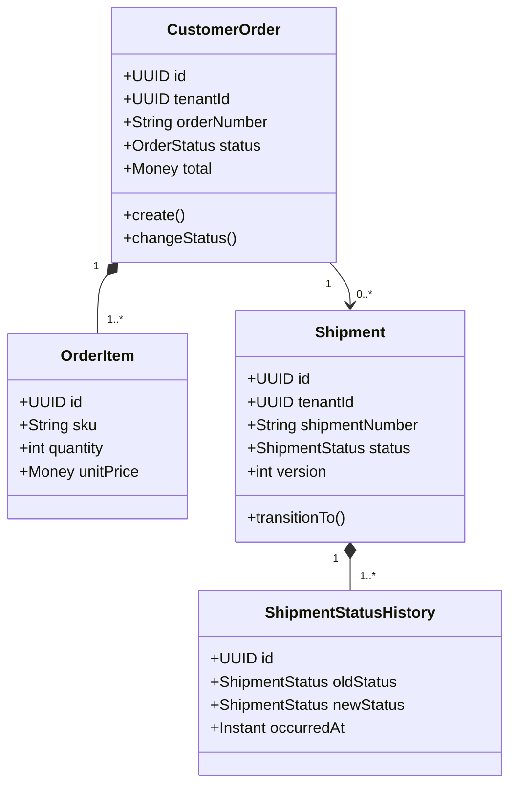
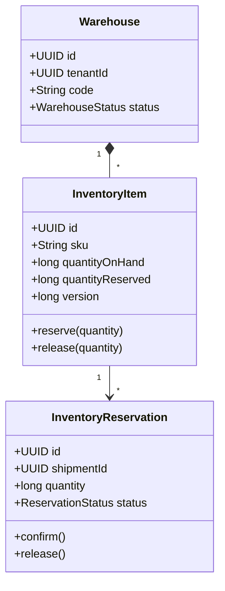
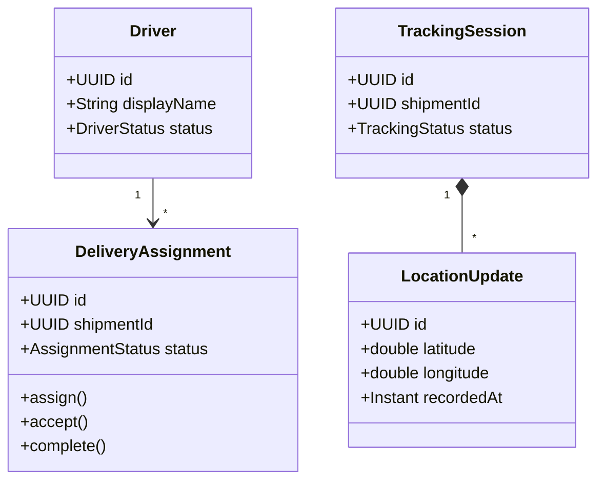
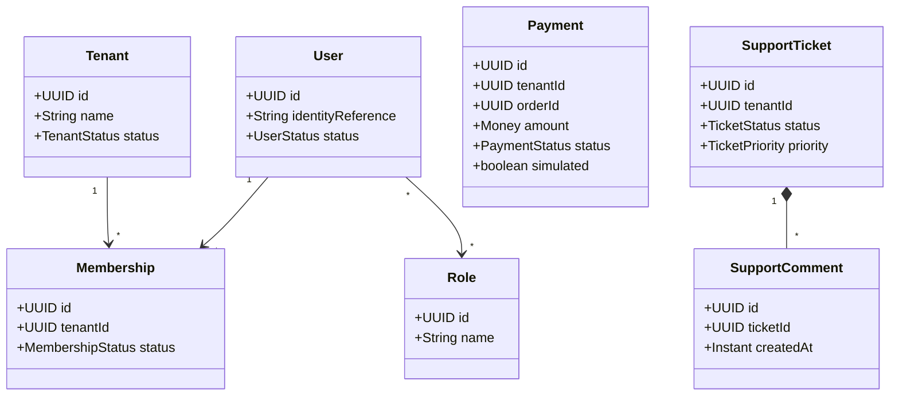

# FleetPulse – Class Diagrams

**Status:** Illustrative domain model – implementation detail may evolve  
**Revision:** 1.1

> These are domain-level diagrams, not generated Java class diagrams. Keep service boundaries intact; do not create cross-service entity relationships.

## 1. Order and shipment domain

## 2. Warehouse and inventory domain

## 3. Delivery and tracking domain

## 4. Identity, payment and support (additional domain sketches)

These are illustrative classes only. Identity/tenant relationship and role assignment details must follow the approved IAM design. Payment is simulated in v1; no real payment provider credentials or settlement objects are modeled. Notification templates/records, audit records, customer addresses and stock movements also require detailed class-level design before implementation.

## 5. Application-layer pattern

Within each service, a typical structure is:

- `controller`: transport concerns, request/response DTOs.
- `application`: use cases and transaction boundaries.
- `domain`: entities, value objects, invariants and domain services.
- `infrastructure`: repositories, messaging adapters and external clients.
- `config`: security, persistence and observability configuration.

Keep domain objects independent of HTTP and broker-specific types. Use DTOs at API boundaries and explicit event payload types at messaging boundaries.
