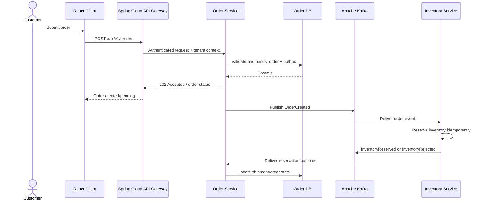
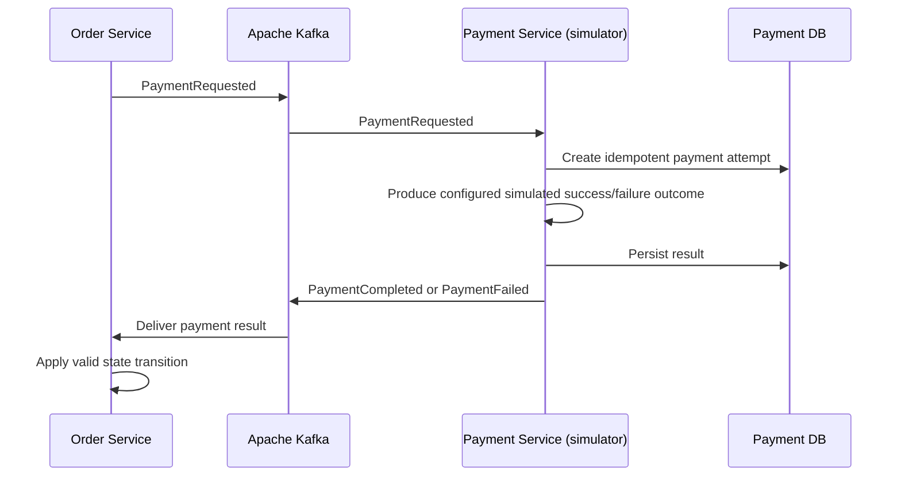
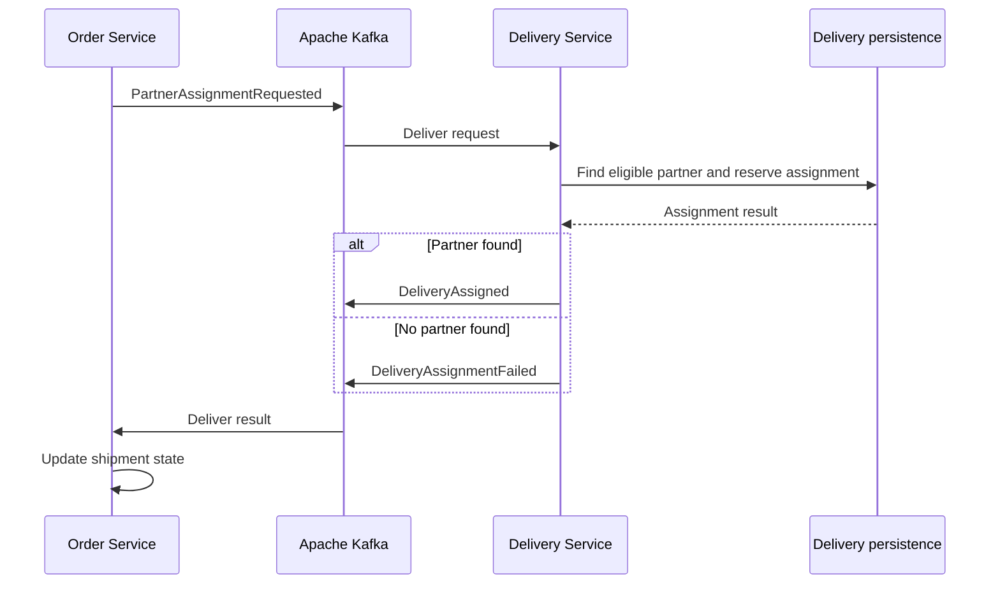
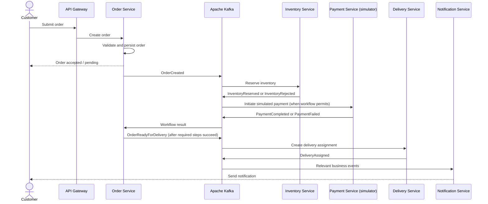
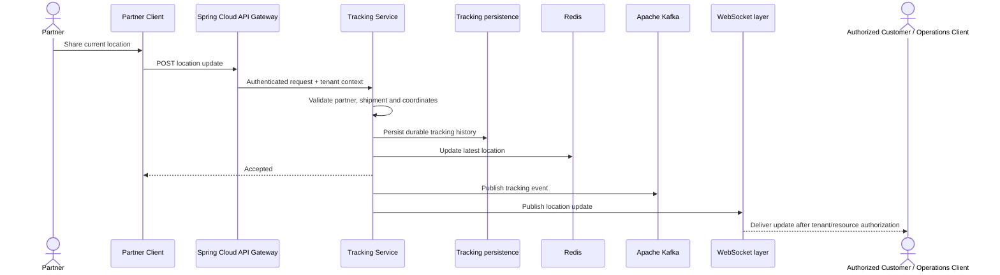

# FleetPulse – Sequence Diagrams

**Status:** Illustrative workflow proposals – aligned to HLD sequence; Saga ownership and compensation remain open  
**Revision:** 1.1

## 1. Create order and reserve inventory

## 2. Payment simulation

## 3. Partner assignment

## 4. End-to-end order fulfilment (HLD workflow)

The HLD labels this workflow illustrative. Exact step ordering, payment timing, orchestration owner, failure paths and compensations remain open and must be reconciled with the SRS before implementation.

## 5. GPS tracking update

## 6. Important workflow guarantees

- Every write command is authorized and tenant-scoped.
- Repeated client requests must not create duplicate orders/payments/assignments when an idempotency key is required.
- Event consumers must handle duplicate delivery.
- State transitions are validated by the owning service.
- Long-running workflows expose intermediate states and failure reasons.
- Compensation behavior (release stock, refund simulation, unassign partner) must be defined before the corresponding workflow is considered complete.
