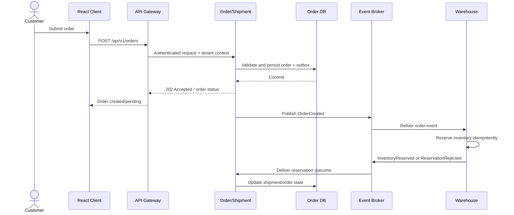
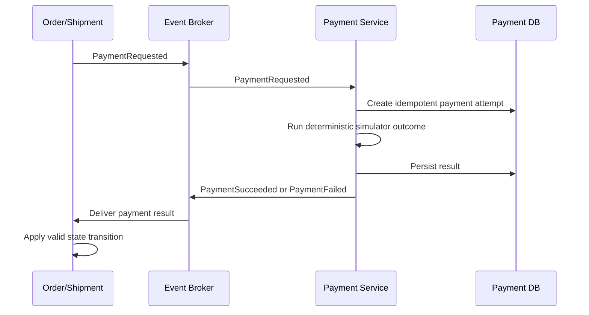
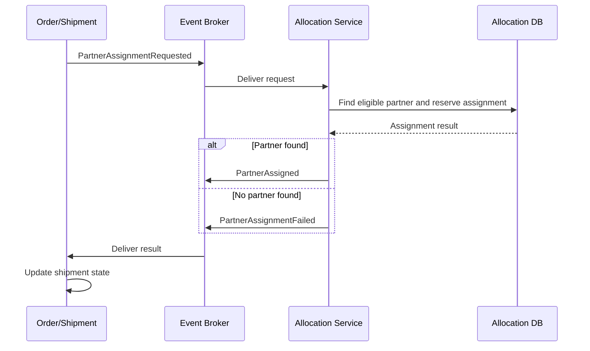
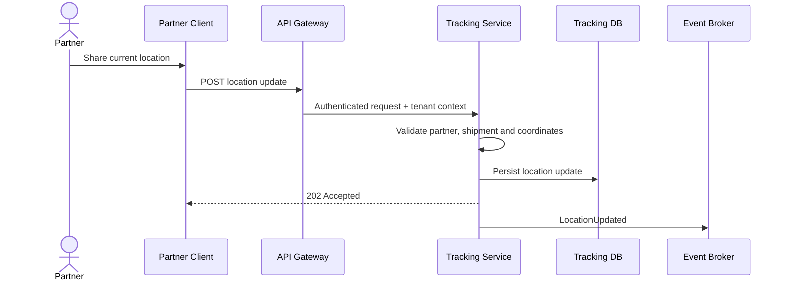

# FleetPulse – Sequence Diagrams

**Status:** Proposed workflows – review required  
**Version:** 1.0

## 1. Create order and reserve inventory

## 2. Payment simulation

## 3. Partner assignment

## 4. GPS tracking update

## 5. Important workflow guarantees

- Every write command is authorized and tenant-scoped.
- Repeated client requests must not create duplicate orders/payments/assignments when an idempotency key is required.
- Event consumers must handle duplicate delivery.
- State transitions are validated by the owning service.
- Long-running workflows expose intermediate states and failure reasons.
- Compensation behavior (release stock, refund simulation, unassign partner) must be defined before the corresponding workflow is considered complete.
