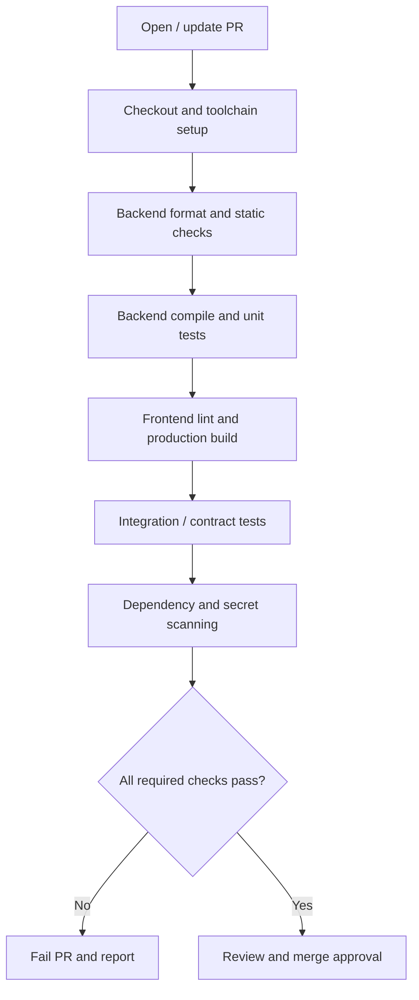
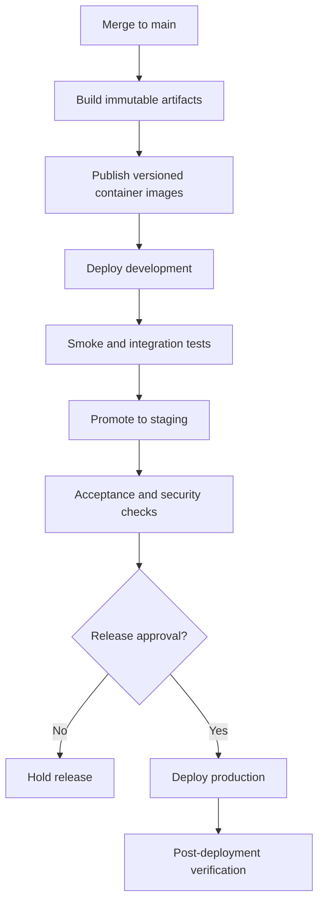

# FleetPulse – CI/CD Design

**Status:** Draft – aligned to BRD/SRS v1.0 and HLD v1.0; pending review GitHub Actions pipeline – align workflow files with the actual repository configuration  
**Revision:** 1.1

## 1. Pipeline goals

Provide fast feedback, repeatable builds, security checks, immutable artifacts and controlled promotion. The completed foundation milestone already established local builds/tests and merged PRs; this document describes the target pipeline as the platform grows.

## 2. Pull request pipeline

## 3. Main branch and release pipeline

## 4. Required checks

- Backend: Java 21 toolchain, Maven wrapper, Spring Boot build, compile, unit tests and integration tests as appropriate.
- Frontend: React + TypeScript; pinned Node version, install from lockfile, lint, format check and production build.
- Static analysis and dependency vulnerability scan.
- Secret scanning.
- Container image scan when images are introduced.
- API/event compatibility checks as contracts mature.
- Smoke tests after deployment.

## 5. Supply-chain controls

- Pin action/plugin versions and use least-privilege CI permissions.
- Prefer short-lived federated cloud credentials over long-lived secrets.
- Protect release environments and production approvals.
- Generate artifact metadata/SBOM when practical.
- Do not print environment variables or secrets in logs.

## 6. Caching and reproducibility

Use Maven and package-manager caches without weakening dependency integrity. Commit Maven wrapper and frontend lockfile. Build from clean checkout periodically to detect hidden local dependencies.

## 7. Pipeline ownership

With the BRD/SRS assumption of two primary developers, backend and frontend pipeline maintenance is shared by the developers. Deployment, environment, security and release controls are also shared unless dedicated ownership is assigned. GitHub Actions is the source-document CI/CD baseline.
